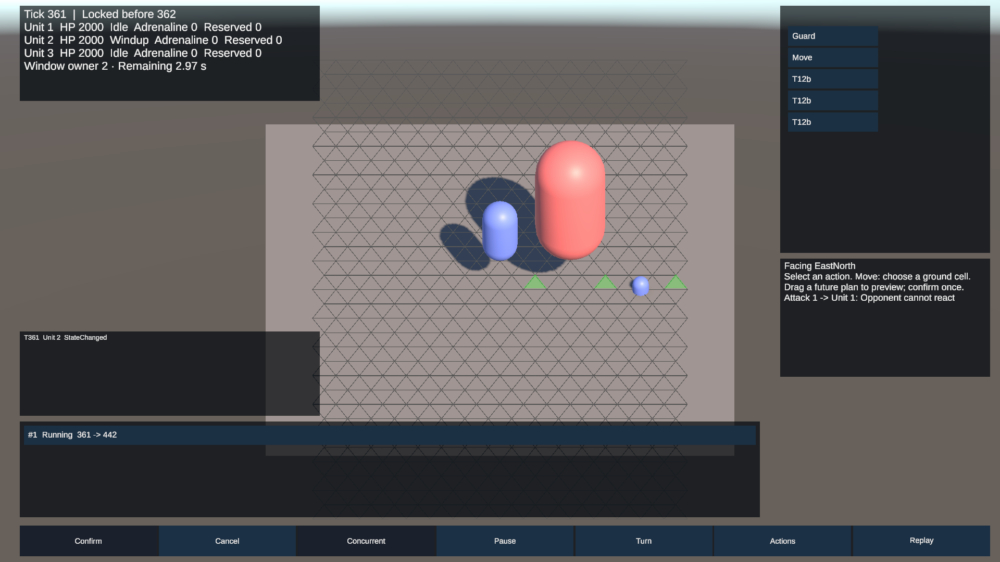

# R1～R4 修订迁移验收

日期：2026-10-14。12A、12B、12C 的规则迁移和 Logic 只读预览完成。正式性能、分配、GC 与完整 HUD M1～M4 仍待后续验收。

## 本轮实测

| 范围 | 结果 | 原始证据 |
|---|---|---|
| Unity 6000.6.2f1 原生 EditMode 全量 | 947/947，0 failed/skipped；12B 的 929 项全部保留，新增 18 项 | [12C-editmode.xml](12C-editmode.xml) |
| 原生 PlayMode 全量 | 67/67，0 failed/skipped；12B 的 65 项全部保留，新增 2 项 | [12C-playmode.xml](12C-playmode.xml) |
| Shadow 前置原生场景回归 | 66/66；排除依赖新结果清单的最终迁移检查 | [12C-playmode-bootstrap.xml](12C-playmode-bootstrap.xml) |
| 12C 必需测试 | 14/14，每项对应本轮实际 Passed 的完整测试名 | [required-tests](12C-required-tests.json) |
| Tick 0 重演 | 14 类战斗文件各 100 次、完整主场景及动态生成回放、4 类防御场景各 100 次、新重击场景 100 次；窗口投影另存文件并从 Tick 0 比对 | 原生 XML 的输出、`12C-11-final-replay-*`、`12C-main-defense-case-*`、[window-preview](12C-window-preview.heroReplay)、[重击](12C-main-opponent-cannot-react.heroReplay) |
| 隐藏 Shadow 场景 | 实际确认未来攻击 1 个、26 帧、73 义务分类、0 未决、0 Shadow 写入；共同面读取真实 Legacy/New 值 | [接受报告](12C-11-migration-shadow-accepted.txt)、[分类](12C-shadow-classification.json)、[指纹清单](12C-shadow-migration-evidence.json) |

逐条结果见 [修订迁移验收矩阵](12-修订迁移验收矩阵-2026-10-14.csv)，覆盖 R1.1～8、R2.1～8 及子项、R3、R4、六类只读预览和设计 §10.4 的全部场景。每行均有本轮实际通过的测试名和证据范围。§10.4“暂停规划”的时钟和既有事务基础通过；暂停中编辑多草稿并在恢复时提交的完整产品流程仍属于 M1，矩阵明确标为待实现，不能据此声称完整 HUD 已通过。

## 可见性与主场景

所有控制者读到相同的 UnitId 排序肾上腺素账本，含 Available、CycleId 与反应预留；他方 Editable 普通计划仍隐藏。预览世界不复制 AI 状态、RNG 或未来输入，运行同一套 Logic 求值器，且不改变权威状态、ID 或 ScheduleRevision；按已提交快照和请求缓存。

第二个演示使用明确记录的三单位场景配置，实际 Canvas 提交重击；Tick 361 预告敌方无可行 Block/Dodge，Tick 441 实际造成 20480 Q10 伤害，无敌方 ReactionTriggered。此时下一非本控制者窗口在 Tick 540，命中处于已知视界内。图片为真实 URP 1920×1080 渲染，已检查文字可见性，不是设计稿。原始事实见 [演示记录](12C-main-opponent-cannot-react.txt)。

## 版本、归档与收尾

规则版本保持 `battle-def-v4-defense-duration`，定义哈希 `e04b3c0946ad3035`，裸 Tick 0 初始哈希 `2046e404a6fb708f`，生产组合初始哈希 `63e751856fe458e8`，Replay 格式 6。R4 增加控制者只读投影，不改变定义、规范战斗快照编码或权威执行，因此不另升规则/回放版本。原生测试重新产出 [哈希锚点](12C-hash-anchors.json)和初始编码。

[最终审计](12C-final-audit.json)逐项检查源码指纹、原生结果指纹、必需测试和基线用例保留；旧任务 01～12B 已跟踪证据与 HEAD 原内容比对，未改写。新结果全部使用 12C 路径。初轮发现的“只允许一个资源账本”旧测试已按 UnitId 定位修正，未删除用例；最终结果未将中间失败或离线测试计入原生通过数。

主方案、设计 v2.1/§10.1、HUD v0.3 前置条件及导航已同步；扫描区分当前状态、任务要求引用与历史文本，见 [扫描记录](12C-state-scan.csv)。本机项目记忆查询未发现需修改的旧规则描述。接口签名、缓存和合法差异条件见 [12C 交接](12C-交接记录.md)。

性能阈值按原任务 01/11 保留且继续延期；本轮没有用 Editor 回归耗时冒充正式负载性能达标。HUD M1～M4 可以基于本轮端口开始实施。
