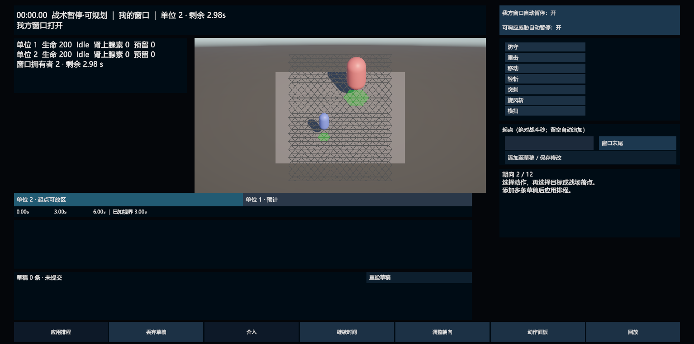

# M1：时钟、窗口与多草稿

2026-10-15 范围补充：本记录证明当时版本的 M1 时钟、窗口、多草稿和已记录操作，不证明 M2 吸附线已接入或 Shadow 已退出生产程序集。后续源码纠偏另按[交互保真与诊断退出方案](../方案/交互保真与迁移脚手架退出方案-2026-10-15.md)执行并单独验证；旧双轨不保留，幽灵插入继续搁置，其他沿用 M1～M3 标准。本页旧 XML、源码指纹及操作记录不作为修改后版本的通过证据。

日期：2026-10-15。本轮实现正常战斗 HUD 的 M1；M2 多单位轨道、M3 完整反应卡与介入流程、M4 时空预览和整体打磨继续按 HUD v0.3 实施。

## 实现范围

- `BattleClockController` 区分进行中、战术暂停、系统暂停和结束。驱动仍由 `BattleRuntimeBootstrap → UnityBattleDriver → Logic` 唯一推进；HUD 不调用权威 Step。暂停在已提交 Tick 边界生效，打断同帧推进，恢复清除积累时间。系统暂停恢复此前的运行或战术状态；重开清除暂停状态。
- `HudFacts` 与 `HudLayoutResolver` 按时钟、提交权限和公开威胁决定布局。我方窗口和可行的新威胁默认自动暂停，可分别关闭；中止自动暂停默认关闭。动画、移动插值、反馈音频和相机反馈随暂停冻结。
- `ScheduleDraftModel` 保存稳定本地 ID 和一份操作队列。配置动作与添加草稿分开；选新动作、编辑或删除一项保留其余意图。草稿的整体预览使用现有 Logic 排程求值器。
- 暂停中的应用仅封存为“待恢复提交”；恢复时重验窗口、修订和预览，通过原有工厂投递一个普通排程事务，在下一正常 Tick 采纳。未应用草稿恢复前提供“应用并继续／保留未提交草稿并继续／返回规划”。反应仍走独立机会命令。
- 入口排队与权威接受／拒绝分开表达。回执按当前控制者与入口序号匹配；待采纳时禁止重复应用或丢弃。过期和拒绝保留意图，必须明确重验或编辑，不自动重试。
- 窗口条显示当前窗口、后续预计窗口、已知视界和起点可放区；支持绝对战斗秒输入和“窗口末尾”定位，精度吸附到 Tick。动作可以跨窗口继续。主界面隐藏 Tick 和开发反馈；诊断信息随开发回放面板展开。
- 规划时调整战场视口，避免底部区域遮挡附近落点。正常中文 HUD 使用 Windows 微软雅黑动态字体，保留原字体作为回退；跨平台发行字体仍需后续配置。

## 原生与操作证据

最终结果已汇总至 [审计](M1-audit.json)与[当前源码指纹清单](M1-shadow-migration-evidence.json)。中间失败结果保留在本轮目录，不计入通过数。

| 原生范围 | 最终结果 | 证据 |
|---|---|---|
| EditMode 全量 | 960/960，0 failed/skipped | [XML](M1-full-editmode.xml) |
| PlayMode 全量前置 | 69/69，0 failed/skipped | [XML](M1-full-playmode-bootstrap.xml) |
| 最终 Shadow 收口 | 1/1；确认未来攻击、26 帧、73 项分类、0 未决、0 Shadow 写入 | [XML](M1-shadow-final.xml)、[实际报告](M1-regression/12C-11-migration-shadow-accepted.txt) |
| 原生键盘输入与焦点 | 1/1，已包含在上述 PlayMode 69 项中 | [定向结果](M1-keyboard.xml) |

合计 EditMode 960 项、PlayMode 70 项。397 份当前源码与程序集文件逐一核验；既有 12C 原始结果未改写。测试重新生成的诊断场景资产已恢复，主场景资产未修改。

真实鼠标操作已完成：暂停中选择战场落点，添加移动、轻斩和窗口末尾重击；检查恢复三选项；返回规划并应用；继续时间后执行。原始状态见 [待恢复](M1-real-mouse-awaiting-resume.json)与[恢复执行](M1-real-mouse-executed.json)：

| 检查点 | 事实 |
|---|---|
| 暂停中应用后 | Tick 0；3 条草稿；AwaitingResume；提交数 0；权威自身计划 0 |
| 恢复后 | 唯一排程事务提交数 1；草稿收到 Accepted 回执 |
| 移动与轻斩 | 移动 Tick 1～26；轻斩 Tick 26～116；均完成 |
| 窗口末尾重击 | 起点 179；结束 389；到 Tick 360 已经历敌方窗口，仍为 Running |

键盘自动化使用 Unity 原生 InputSystem 完整设备状态与状态监视器，经过实际快捷键回调和 uGUI 焦点门禁。批处理窗口和电脑操作工具未能提供 Unity RawInput 物理键盘证据。2026-10-15 用户在 Game 视图完成真实键盘复核，确认 Esc 打开／关闭系统暂停、战场焦点下 Space 继续／暂停、起点输入框内 Space 不改变暂停状态均正常，回复“全部正常”。[人工复核记录](M1-physical-keyboard-verification.json)与自动化证据分别保存。M1 功能与操作验收已通过。

## 历史证据与范围

既有 12C 结果保留。本轮回归生成的战斗文件、哈希锚点和截图转存 `M1-regression/`。三条旧用例按新契约改名或更新：过期意图保留；选目标后需要另点添加；动态单位下令同样经过添加步骤。没有删除用例来规避失败。

规则版本、定义哈希和 Replay 格式沿用 R1～R4。迁移证据加载器改读 M1 清单，必须基于本轮实际通过的完整测试名、结果文件哈希和全部当前源码哈希重新复验；不沿用旧源码指纹。

本轮未提交或推送。正式性能、分配与 GC 仍延期；本轮测试耗时不代表性能阈值达标。
