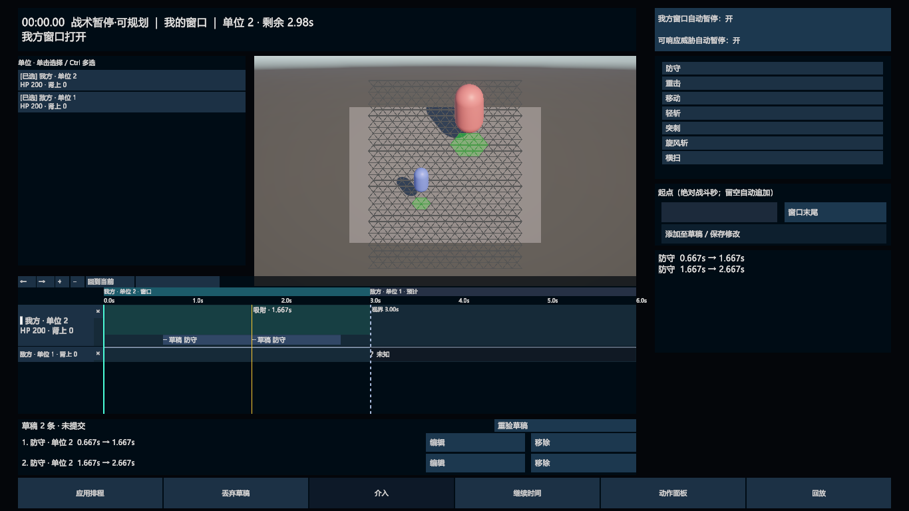

# M2：多单位轨道与吸附线

2026-10-17 后续补验完成：用户确认真实多选、主选切换、拖动吸附、取消、拼刀预告及轨道合拢；完整 Windows Player 构建和独立运行通过。见 [完成记录](M2-M4-补验完成-2026-10-17.md)。下文为此前实施当轮的历史记录，其待验状态已由后续补验更新。

日期：2026-10-15。实现依据：[HUD v0.3](../../设计文档/界面/战斗UI-HUD框架-v0.3.md) §3 与 M2，以及[实施纠偏 C1](../交互保真与迁移脚手架退出方案-2026-10-15.md)。仅保留旧时间轴的关键帧吸附与辅助线；旧双轨和幽灵插入未恢复。

状态：M2 源码已实现，定向原生测试与目标分辨率检查已进行；完整真实鼠标/物理键盘流程和 Player 专项验证仍需单独验收。本轮没有提交或推送。

[1920×1080 多单位轨道截图](M2-1920x1080.png)与[画面状态证明](M2-visual-proof.json)。最终截图确认单位列表可见、两单位轨道共用刻度、黄色吸附线位置正确，草稿文字与轨道预览同步。

## 实现内容

- `TrackSelectionModel` 管理选择集合、主选、历史和临时威胁轨道。单击/Ctrl 单击按新规则增减选择，标题单击只切换主选，关闭按钮取消选择；Tab/Shift+Tab 按轨道顺序切换主选。输入框与选目标状态有输入门禁，Esc 优先取消配置或拖动。
- `TrackLayoutModel` 按可控/友方/中立/敌方分组，再按初始化槽位顺序和动态 SpawnId 的 Ordinal 顺序排序。窗口轮转、点击顺序和主选变化不改变排序；取消选择后其他轨道合拢。自动暂停加入窗口拥有者；威胁暂停加入受威胁单位和临时攻击者，威胁结束时清理未被玩家保留的临时轨道。
- `M2TimelineView` 挂在现有时间轴区域，接替原列表区域。轨道共用窗口条、刻度、视界、当前时间线、缩放和平移；“回到当前”常驻。主选轨道为 64px 加 24px 草稿行，其他轨道 32px；阵营间有分隔。单位列表和轨道列表可滚动，主选自动滚入视野，溢出的已选单位有 `+N` 入口。
- 主选决定配置器下令主体。选中不可控单位时只显示其公开信息，不提供其动作下令；原有草稿不因选择变化丢失。空选择仍保留窗口、刻度和公开威胁汇总。战场点空地不清空选择，等选目标/落点时点击仍归配置器。
- 已有计划与本地草稿按整数 Tick 绘制，攻击显示前摇、命中点和后摇。可编辑计划和草稿拖拽只更新同一份 Model 事务预览；取消拖动恢复原意图，其他草稿及稳定 ID 保留。非法位置显示为红色，采用最后一次已解析时长表达请求位置，不在 View 重算排程。
- `TimelineSnap` 读取当前公开/自身投影的实际起点、命中点和终点；吸附阈值为 0.15 秒，换算使用定义 Tick 频率及 Canvas 局部坐标。历史终态不成为吸附锚点。实际 Logic 预览未保留对齐时清线；取消、过期、锁定、系统暂停和结束拖动也会清线。没有新增幽灵插入推挤流程。
- Logic 只读端口新增 `PreviewTimelineContacts`，复用既有过滤后的预览世界与原生 Step 求解，返回命中、拼刀、格挡、闪避或移动接触事实。UI 不根据 Tick 对齐自行判拼刀。已选接触对象用跨轨道连线表达，未选对象用可点击标签加入；新草稿接触点按稳定草稿键映射，避免隐藏计划影响候选 ID 时连错动作。
- 正常运行时的轨道绘制和接触查询按 HUD 的 0.1 秒刷新节奏更新；编辑、修订、选择和暂停变化立即刷新，不在 Driver 同帧补多个 Tick 时逐 Tick 重建整套 UI。

## 发现并修复的问题

1. 未来窗口投影可能包含尚未正式生成的单位。标题现在显示“预计单位”，不查询当前尚不存在的阵营关系；动态生成回归已重跑。
2. 滚动单位列表的透明 Mask 图形会遮掉其内容。已改为有效的遮罩图形，背景仍不显示；最终截图已核对列表可见性。
3. 拖动时草稿列表文字曾落后于轨道预览；已同步刷新配置器与草稿文字。
4. 新建攻击尚未出现在已提交快照时，接触查询必须读取预览世界当前计划注册表；已补覆盖测试。

## 原生测试证据

| 范围 | 结果 | 结果文件 |
|---|---|---|
| M2 选择、排序、吸附边界、Logic 命中/拼刀/新草稿接触及只读性 | 8/8 | [最终 EditMode](M2-final-editmode.json) |
| M1 时钟/多草稿与 M2 选择、不同缩放下拖拽、取消、系统暂停及原生 Ctrl/Tab/Esc/输入框焦点 | 7/7 | [最终 HUD PlayMode](M2-final-hud.json) |
| 已有时间轴拖拽/删除/修订竞争 | 2/2 | [时间轴回归](M2-timeline-regression.json) |
| 动态生成、主选下令与确定性 Replay | 1/1 | [修复后回归](M2-dynamic-final.json)，[初次失败](M2-dynamic-initial-failure.json) |

最终定向范围共 18 项，通过 18 项，无失败/跳过。`git diff --check` 通过。

这些 JSON 是 Unity 原生 Pipeline Test Runner 的逐项结果，不是离线模拟测试。中间 NUnit XML 保留作迭代记录；最终结果以表中 JSON 为准。整类 `Task10WiredPresentationTests` 的一次较长运行被取消，不能计为全类通过；本轮只记录完成的定向范围，没有宣称全量回归或性能门槛通过。

## 画面与输入证据边界

目标分辨率使用 Game 视图的固定尺寸，核对 `Screen.width/height`，不以把截图缩放成对应尺寸代替。截图通过 Unity `ScreenCapture` 保存。原生 uGUI 拖拽事件验证了 Tick 10 → 40 吸附到 Tick 100，另一草稿仍为 Tick 100，权威提交数为 0。

电脑操作工具已实际完成单位取消选择。工具的键盘注入及鼠标拖动未稳定产生预期的 Unity RawInput 状态变化，未计为物理键盘或完整鼠标拖拽验收；原生输入设备状态与 uGUI 事件验证另列，不混为真实操作通过。M2 仍需用户在 Game 视图完成 Ctrl 多选、Tab 切主选、拖轻斩对齐公开命中点并看到拼刀预告、取消选择后轨道合拢的完整流程。

本轮未恢复旧 Canvas、双轨或幽灵块，未实现 M3 完整反应卡、M4 空间残影，也未拆分 Shadow 程序集。现有历史 XML/JSON 报告保留；部分既有 PlayMode 测试会重写 `M1-regression/` 下的共享截图/回放输出，本轮重跑后的这些文件应视为新生成内容，不能继续当作原 M1 版本画面证据。
