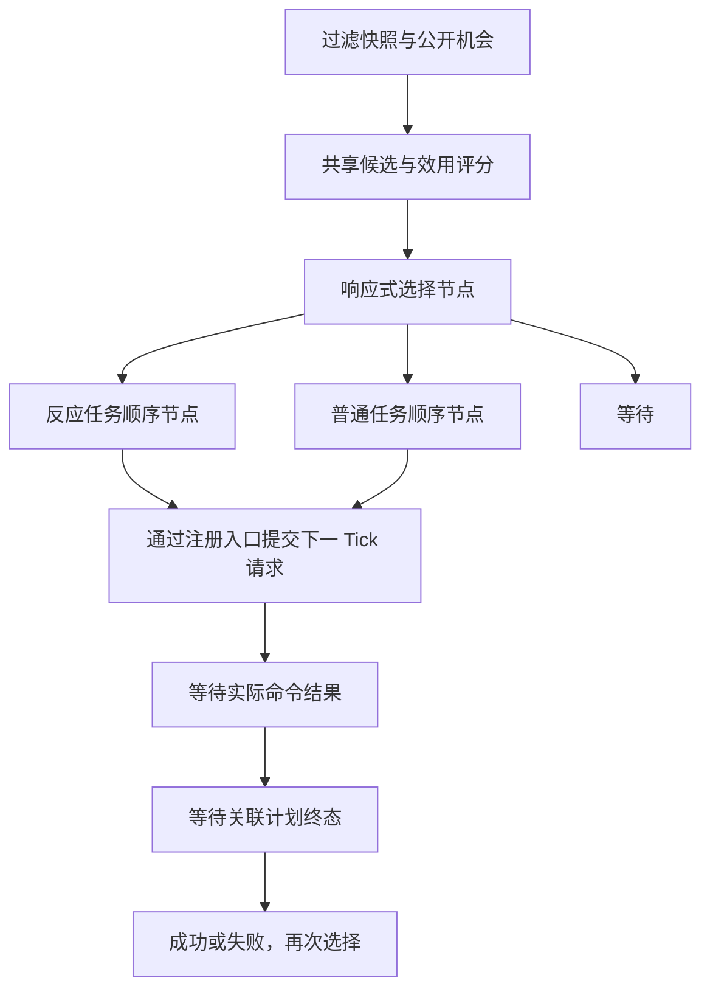

# 正式动作基线与最小效用 AI＋行为树

任务：[16](../../16-正式动作基线与最小混合AI.md)。2026-11-05 完成正式动作基线和最小混合执行框架。全量 EditMode **1116/1116**、生产/Shadow 定向 PlayMode **15/15**、正式内容 **24 场 / 21,600 Tick** 的逐场与独立进程磁盘回放均通过；另通过旧 V2 **16 场 / 17,970 Tick** 代表回放兼容验证。

## 动作来源

编辑器工具打开 `Assets/Scenes/CombatSampleScene.unity`，读取主场景的 `NewBattleSimulationSource.BuildSeed()`，由正式 Authoring 构建入口读取 Resources。保留输出的全部动作、动作集、单位属性、攻击范围、体积和规则对象；未构造替代攻击，也未创建正式动作资产。

本轮使用当前正式规则 `battle-def-v5-clash-recovery`，仍是正式旧数值分支。独立 v0.5 实验继续保留，不能把本轮与旧合成场景合并为平衡结论。每个体型有快斩、重砸、横斩、突刺和旋风五种正式攻击，以及共用的 Guard、Move、Block、Dodge。

24 场登记为三种评分风格 × 两种执行模式 × 两种布局 × 两种镜像方向。普通模式保留 V2 单步选择；混合模式采用相同候选、真实内核预演和评分权重。布局为正式定义的原出生位置，或显式近距 `(-4,0)/(4,0)`；镜像同时旋转朝向。两方均改为注册 AI，先手按生产装配现有排序确定，本轮没有独立交换先手；每场最多 900 Tick，固定使用主场景种子与初始资源。

动作未被选中不代表没有候选。测试逐一断言当前角色动作集中的五种攻击都进入候选；原始候选评分另存于逐场文件。实际命中仍取决于范围、对方应对和真实战斗结果。

## 已实现的架构

首版以通用动作任务为单位。树具有真实的 Sequence、Selector 与 Running/Success/Failure；任务保存节点位置、请求 Tick、由入口分配的生产者序号、实际计划编号及衔接前序计划编号。命令处理器反馈本次请求的拒绝原因或创建的计划；AI 再读取自己计划的自然完成或终止状态。请求被入口接受、被规则接受、动作自然完成分别处理。

普通与反应分别保存任务进度。反应分支每 Tick 检查，普通任务在此期间保留；两条分支都先确认已有请求，防止反应优先使普通请求的回执遗漏。切换分支不取消或重排战斗计划。状态随既有逻辑 Tick 推进并进入规范化快照/哈希，没有新增时钟。未启用混合模式的旧快照编码保持原样。

任务结果按实际终态原因映射：自然完成、反应已触发、Guard 额度已用尽属于执行完成；命令拒绝、缺失结果和非正常中断使任务失败并重新选择。执行完成不代表一定造成伤害或成功避伤，效用仍读取真实预演结果。修正前的结果分类及一致命令对照保留在 `outcome-before-fix/`。

当前仲裁明确保留 V2 的反应优先规则，以及合法反应无正收益时等待的规则。三组偏好拆成 `AiUtilityProfile`，权重与原算式等价；计数项仍是实验选择偏好，未新增战斗奖励，尚未做权重尺度重标定。

排程允许在前一动作结束前一个 Tick，提交从其半开区间结束边界开始的下一动作。树保留前序计划关联，继续等实际终态；合法衔接仍经原入口和排程校验，避免框架额外引入一次决策间隔。反应任务也会为规则允许的普通动作衔接让出树分支，已提交的反应计划仍由战斗规则处理。

初版曾在此边界额外等待，把一次 Tick 126 的选择推迟到 Tick 132；该版本及 24 场记录保留在 `initial-task-wait/`，反例见 `finding.json`。专门回归测试先复现差异，再验证修正。`completion-boundary-before-fix.xml` 保存修正前的失败，最终验收使用本目录新的正式对照与测试结果。

同类新招式通过动作定义和角色动作集接入这些共享任务；Cast、Item 等未支持机制会输出动作 ID 诊断。新的机制仍需实现对应候选、评估和命令适配。候选数有记录，目前没有新增候选裁剪策略或预演预算上限。

这次完成最小任务执行框架。持续战术目标、接近后攻击等跨动作任务、目标切换阈值、对手预测及多步搜索还未实现。每个控制者当前各有一个普通任务和一个反应任务；多人共用控制者时的并行任务管理留待后续扩展。正式场景的默认配置尚未切换；场景测试在内存中启用敌方混合模式。

## 正式内容暴露的下一项限制

当前 V2 与首版混合模式都使用 120 Tick 的预演视野。在正式近距局面 Tick 0，R2 动作候选解析为起点 Tick 1：突刺命中 97，横斩命中 121，重砸命中 181，旋风命中 241。后三者的命中落在当前预演终点之外，其伤害收益尚未发生，时长代价却已计入。因此“有候选但未选择”在这里还包含预演覆盖不足，不能直接归为权重过低或招式数值偏弱。

下一轮应先在同一正式内容上补齐长动作的预演覆盖，并约束候选与计算量，再扩展连续战术任务。此轮保持 V2 选择行为作为结构对照，不同时改变预演视野。原始示例见近距场次 Tick 0 的攻击候选：横斩 / 重砸 / 旋风当前均为零预测伤害，突刺为 25600 Q10。

## 固定对照结果

最终 24 场共 21,600 Tick，12 组配对的逐 Tick 选中命令、生命、命令数、攻击、移动与反应次数全部一致，命令拒绝为零。每场均运行到 900 Tick 截止，尚未结束，不能据此计算完整战斗胜率。单次决策最多评估 44 个候选，10 个正式攻击定义都进入候选，没有未支持动作诊断。

| 执行模式（各 12 场） | 命令 | 攻击启动 | 移动启动 | 反应创建 |
|---|---:|---:|---:|---:|
| V2 单步选择 | 150 | 80 | 8 | 62 |
| 效用＋行为树 | 150 | 80 | 8 | 62 |

两种模式实际选择完全一致：R2 突刺 44 次、R1 突刺 34 次、R1 快斩 2 次、Block 30 次、Dodge 32 次、Move 8 次。没有选到某招不是其数值无用的结论，尤其受上述预演视野和单挑布局限制。

混合模式观察到 104 个执行完成状态、2 个被拼刀中断的失败状态。此处是任务状态观察数；衔接时前序任务另有计划关联，不能把该数直接等同于全部权威计划的终态次数。`analysis.json` 的失败观察 Tick 数也不是失败动作数，持久状态可能跨多个 Tick 重复出现。

## 证据与复跑

源正式定义摘要为 `de4be447760a2266`。最终 427 个 C# 文件的摘要为 `616049c79e2bda81958996b74ca199144002e29376238c2903721a42b2d0fdac`；正式内容摘要为 `214c841cb9d10299de05d2d49a53f050e39713f7fe1aaf55d07ce3fd3a928690`。正式 Resources 与主场景的原始文件未改写。验证只覆盖本页列出的场景与范围，没有进行最终平衡定值或正式默认 AI 切换。

- `formal-actions.txt`：源定义摘要、正式动作和动作集。
- `cases/*.input.json`：规则、定义、内容及代码摘要与显式场景参数。
- `cases/*.candidates.csv`：逐 Tick 候选、预演结果、拒绝与选择。
- `cases/*.decisions.csv`：选择、等待、普通/反应任务节点、计划编号、结果与未支持动作。
- `cases/*.heroReplay`：逐 Tick 事件和规范化快照摘要；双方 AI 在回放中重新生成输入。
- `summary.csv`、`analysis.json`、`paired-comparison.json`：对照结果及汇总。
- `full-editmode.xml`、`production-shadow-playmode.xml`：逻辑与场景验收。
- `native-disk-audit.txt`：独立进程重建正式定义并从磁盘验证 24 场回放。
- `native-v2-compatibility.txt`：新代码验证旧 V2 的 16 场代表回放（四组场景 × 31/40 × 两组镜像先手/站位）；原 96 场封存文件另作全量摘要核对。
- `before-task.zip/json`：本任务开始时的既有文件；`source-and-content.zip`：本轮源码及正式内容；`restoration.json`：测试生成文件的恢复记录。

Unity CLI 固定使用用户指定的 beta.13、Editor 6000.6.2f1。批处理入口为 `ProjectHero.Editor.FormalAiBaselineTools.Run`、`Audit` 和 `AuditV2Compatibility`；收口分析为 `evidence.py analyze`，文件保护与归档为 `restore`、`seal`。原始归档不覆盖。
