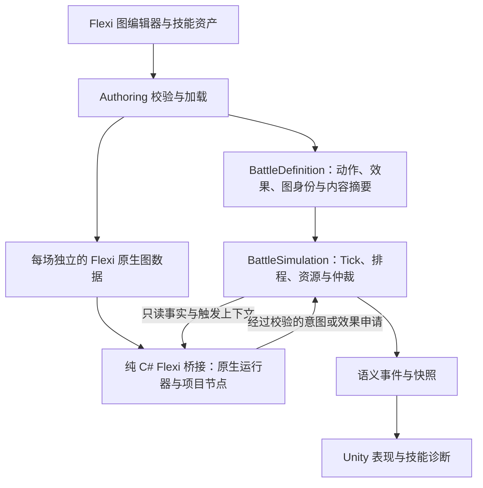

# Flexi 试接入与技能制作方案 v0.1

日期：2026-10-21。

状态：延期，保留备查；尚未安装依赖或实施功能。2026-10-21 用户明确当前阶段没有引入复杂技能的打算，游戏尚未实现魔法，因此本方案不作为当前实施任务。

关联：[GAS 框架选型调研](GAS框架选型调研-2026-10-21.md)、[当前玩法](../游戏设计文档.md)、[主架构方案](../../优化任务/方案/优化方案-逻辑表现解耦与逻辑帧判定.md)。

当前方向是改善现有攻击、移动、防守、格挡和闪避的配置、校验及制作流程。燃烧、格挡加速和可视化技能图属于此前拟议的试验样例，不因此进入当前玩法范围。

后续设计魔法或其他复杂能力时，可重新评估框架。重新评估应由真实的效果组合、持续状态、条件触发或跨技能联动需求驱动；加入魔法本身不等于必须采用 GAS。以下保留原试接入设想，文中的“首轮”“本轮”及 F0～F4 均指该延期试验，新增类型、目录、规则和接口均未实施。

## 1. 目标与采用方式

**让 Flexi 承担技能图编辑与执行，让现有战斗内核承担时序和结算。** 首轮以普通攻击、命中燃烧、格挡增益三个样例验证实际制作收益，之后再决定正式采用范围。

期望的制作体验：程序提供一组可复用节点与效果类型；制作人员复制技能模板、填写参数、连接条件与效果，执行校验后加入单位技能集，即可在试验场景中预览和运行。同一类技能的变体不再要求修改 BattleSimulation 或新增专属技能脚本。

首轮实际复用 Flexi 的图编辑器、原生图数据和流程运行器，并考察 Stat/Modifier。项目新增的是接入节点、规则端口与验证，不另建图编辑器、图语言或通用执行器。若必须重写这些核心才能使用，应判定接入收益不足。

范围分为两步：

- **接通验证：F0～F1。** 锁定依赖、核实边界，让一条现有攻击通过 Flexi 运行并保持行为等价。
- **制作验证：F2～F4。** 增加周期效果与被动属性修改，用配置产出变体，验证回放、编辑器使用及 Player。

本轮先支持同步、有限步骤的事件图。多段攻击、弹道、召唤、吟唱、网络同步、任意跨 Tick 的图暂停续作列为后续扩展，不纳入首轮完成条件。技能前摇、后摇和 Buff 持续时间仍由现有 Tick 系统表示。

## 2. 已知事实与第一阶段必须查明的事项

### 项目现状

| 已核对的代码事实 | 方案中的处理 |
|---|---|
| Unity 为 6000.6.2f1；Logic 的 `noEngineReferences` 为 true | 在同版本验证；运行时桥接及其传递依赖也要能脱离 UnityEngine |
| `DrainIntents` 在阶段 8 按稳定计划顺序物化攻击 Intent | 在该物化入口接入技能图，继续复用 Intent 工厂和原有序号分配 |
| `BuffSystem` 已管理效果实例、到期、延迟增删；DoT 目前每 Tick 扣血 | 扩展现有效果内核以支持周期与叠层，不另建计时管理器 |
| `TryGetOwnerFacts` 当前从 UnitDefinition 读取 ActionSpeed/MoveSpeed | 属性增益需要接通这里以及预览所用的同源属性查询；只改图中的属性值不会自动影响动作 |
| `DamageChannelResolvedEvent` 和 `BlockResolvedEvent` 已承载结算事实 | 从已提交的事实产生技能触发，避免把“攻击发起”当成“命中” |
| ReplayPlayer 从初始条件创建新世界并重演，不从 LogicSnapshot 恢复 | 扩展完整重演和逐 Tick 哈希；首轮不新增存档点恢复系统 |

源码入口见第 8 节。

### Flexi 基线与未验证边界

试验基线建议使用 **v0.14.1**。发布页关联提交显示为 `51da089`；F0 获取时记录完整 SHA、包文件校验值和实际导入文件清单，不依赖浮动分支。[发布页](https://github.com/PhysaliaStudio/Flexi/releases/tag/v0.14.1)

官方文档给出 `TryEnqueueAbility` / `Run` 调用方式、自定义节点与项目对象接线方式，支持本方案的验证方向；具体签名以锁定版本源码为准，Wiki 中不同时间的示例不能直接混用。[API](https://github.com/PhysaliaStudio/Flexi/wiki/API-Summary)、[自定义节点](https://github.com/PhysaliaStudio/Flexi/wiki/2.-Custom-Node)

F0 必须核对：

1. Runtime、Authoring、Editor 的程序集和传递依赖；图数据脱离 ScriptableObject 后能否独立运行。
2. 原生运行器的节点/事件执行顺序、缓存与复用方式；一次图执行结束后是否存在会影响下次结果的隐藏状态。
3. 图字段、连线和节点 ID 的序列化规则；运行时是否修改共享定义。
4. Stat/Modifier 数值类型、组合顺序、撤销方式与状态导出；能否保持现有量化规则。
5. 图编辑器在 6000.6.2f1 中打开、连接、保存、重开以及 Player 编译的实际表现。

这些是采用条件，不能以 README 宣称纯 C# 或支持 Unity 6 代替验证。

## 3. 架构与状态所有权

图表示运行时数据流。程序集引用应为：**Flexi 桥接 → Logic 定义的接口；Flexi 桥接 → Flexi Core；UnityAuthoring → 两者并负责装配**。Logic 不直接引用第三方类型，也不向 UnityView 请求技能结果。

| 内容 | 唯一权威 |
|---|---|
| 技能配置与图连线 | Authoring 资产；战斗开始后使用其冻结版本 |
| 图节点的执行 | 每场独立的 Flexi 运行器；通过项目接口接入 |
| 行动是否允许、排程、成本和命中时刻 | 原有 ActionPlan、ActorLane、门禁和资源事务 |
| 命中、格挡、伤害、冲击和位移 | 既有 Intent / Resolution 链路 |
| Buff 实例、来源、叠层、到期、周期和下一次触发 Tick | 扩展后的现有 BuffSystem |
| 基础属性与活动修正 | 基础值来自定义、修正来源来自效果实例；通过单一属性求值入口得到当前值 |
| 下一 Tick 待施加的技能效果 | Logic 内的有序待处理队列，进入快照 |
| 动画、粒子、音效、状态图标 | 表现层消费逻辑事件；不反向决定命中或扣血 |

**Stat/Modifier 的复用原则：** 优先将 Flexi 的实现作为 ActionSpeed 的唯一属性求值器，由 Buff 生命周期添加/撤销修正；Logic 侧需要的当前值只是只读投影，不再并行计算另一套结果。活动修正必须能用稳定数据枚举或重建。若这一路径无法满足数值与状态审计要求，记录为明确缺口，不悄悄改成自研全套属性框架。

**资产边界：** Authoring 在开战前把原生图加载成不含 Unity 对象的运行数据，桥接按稳定图 ID 查找；BattleDefinition 只包含纯数据标识、绑定、参数和内容摘要。装配时验证摘要与实际目录一致。图运行时不读取 Resources、AssetDatabase、场景或可变 ScriptableObject。

**实例隔离：** 只读图定义可共享，节点实例、黑板、运行队列和属性缓存按场次隔离。F0 证明原生重置机制可靠后才复用实例；暂停续作、随机节点和自递归事件暂不开放。若原生数据无法以小范围适配达到此边界，F0 结束后记录不通过原因，再调整方案。

## 4. 技能配置与节点范围

一个技能由三部分组成，使用稳定 ID 关联：

| 部分 | 首轮字段与职责 |
|---|---|
| 动作定义 | 继续使用 ActionSpec：动作类型、时序、范围、目标关系、伤害载荷和费用；是预览与提交的共同依据 |
| 技能图绑定 | AbilityId、GraphId、拥有者/ActionSpecId 绑定、入口事件、参数、定义版本；被动由单位技能配置授予 |
| 效果定义 | EffectSpecId、持续 Tick、周期 Tick、叠层策略、参数和表现键；补全现有状态效果目录 |

避免同一伤害、范围或时序在 ActionSpec 与图中各写一份。普通攻击图读取绑定的已验证动作载荷；F1 不允许图运行到命中阶段才改变攻击范围、时长或目标规则，否则预览和反应机会会失真。

首轮拟提供的节点按职责分类；实际类名在 F0 后按上游扩展 API 确定：

- 入口：攻击到达命中时刻、造成有效伤害、格挡成功。
- 查询与条件：读取触发者/目标、读取结算事实、检查条件、读取定义参数；优先复用可满足约束的原生值节点与流程节点。
- 输出：请求生成当前计划的攻击 Intent、请求施加指定效果、请求该效果关联的属性修正。

这些节点只持有只读上下文与受限输出端口，不拿到可随意写入的 BattleSimulation。伤害/效果输出先进入本次执行的缓冲区，全部通过校验后再交给所属阶段处理。

首轮图校验要求：入口与绑定一致、必填端口连接、ID 可解析、参数合法、控制流无环、输出数量有上限、无引擎对象、无墙钟/系统随机/任意反射节点。保留原生运行器；通过受支持节点集合和资产校验限定执行范围。若原生运行器无法在此范围内有界完成，视为 F0 未通过。

制作流程：复制模板 → 选择动作/效果与事件 → 配置参数和连线 → 校验 → 加入单位配置 → 运行试验场景 → 查看触发和效果记录。F4 需提供一页操作说明与三个可复制模板。

## 5. 接入时序与失败处理

阶段编号沿用当前 `StepPhase`，保持 20 个阶段的整体顺序。以下阶段内扩展及新效果语义属于拟议规则，实施相应阶段时同步主方案、RulesVersion 和测试。

| 时刻 | 拟议行为 |
|---|---|
| 提交/编辑计划 | 原有预览、行动窗口权限与时序采样继续执行；普通动作没有时间费用或行动预算，反应沿用肾上腺素事务，图不另行扣费 |
| Tick T，阶段 8 `IntentDrain` | 对到期且非终态的 AttackPlan，调用绑定图一次；必须恰好返回一个“使用绑定攻击载荷”的请求，再由原有工厂创建 Intent、分配原有序号 |
| 阶段 9～13 | 维持既有闪避、冲突、伤害、位移结算；图不能插入额外即时伤害 |
| 阶段 14 末尾 | 从本 Tick 已提交的权威结算事实生成技能触发，稳定排序后同步运行被动/命中图；产出效果申请，安排在 T+1 执行 |
| Tick T+1，阶段 1 | 先执行原有到期与效果推进，再按稳定顺序处理到期效果申请、刷新属性；本轮新效果不追溯执行刚结束的效果推进 |
| 阶段 2及后续命令阶段 | 新状态和属性对后续命令可见；已创建计划保持原有相对时序 |
| 阶段 19 | 只做检查、归档与输出；不从输出 EventBatch 回调再写战斗状态 |

为什么附加效果从下一 Tick 生效：给“命中后燃烧”和“格挡后增益”一个明确边界，避免同一 Tick 反向修改已经结算的冲突。以后确需即时反击或即时护盾时，单独设计其结算阶段。

触发使用与对外事件相同来源的提交事实，通过一个只读映射产生上下文；不要重新计算命中结果。建议排序键为 `(事实Tick, 事实Sequence, OwnerUnitId, AbilityId, TargetUnitId, 输出序号)`。输出序号来自确定的图执行顺序；在 F0/F1 证明其稳定。

去重按业务语义处理：燃烧按“攻击计划＋目标＋能力绑定”每次命中最多施加一次；格挡被动按“格挡计划＋能力绑定”最多触发一次，即同一次格挡抵抗多个攻击也只触发一次。去重状态以本 Tick/本批为限，跨 Tick 待处理内容由队列自身身份管理并进入快照。

效果申请执行前检查目标仍存在、存活且生命大于零。死亡/战斗结束清理待处理申请；来源死亡不自动取消已经命中产生的燃烧。试验中不支持“死后触发自身增益”。

配置错误在开战前拒绝；目标在下一 Tick 失效等可预期情况用稳定原因码跳过。运行中出现图异常、非法输出或重复攻击请求，丢弃该次尚未提交的输出并使试验明确失败，保留定位信息；不静默切回旧实现，也不回滚此前已合法提交的伤害或资源。

## 6. 三个验证样例

以下默认值仅用于试验，均进入配置及版本化规则，不作为正式数值平衡。

### A. 普通攻击：证明链路等价

选一条现有攻击：`到达 ImpactTick → 读取绑定攻击载荷 → 请求生成攻击 Intent`。

旧路径与 Flexi 路径以试验装配方式二选一，每个计划只有一个 Intent 生产者。对照命中、落空、格挡、闪避、取消、死亡、并发攻击和排程编辑，要求计划时序、费用、Intent 与既有结算事件一致。

F1 的图不新增玩法语义事件，诊断使用独立追踪。若定义结构因技能绑定发生变化，明确区分定义哈希与业务结果等价；不能把跨版本定义哈希不同当成战斗差异，也不能忽略业务字段差异。同一 Flexi 定义重复重演必须得到完整一致的快照哈希和事件。

### B. 命中燃烧：证明效果组合与叠层

图：`有效伤害事实 → 目标仍符合条件 → 申请燃烧`。

有效伤害定义为本次接触结算后的伤害总量大于零；完全抵抗和成功躲开的接触不触发。持续伤害首轮不再次触发该入口，避免燃烧自我续燃。

建议试验规则：

- 效果于 A=T+1 施加；持续 240 Tick、周期 60 Tick；首次在 A+60 生效，随后 A+120、A+180，到 A+240 先到期，不再跳伤害。
- 按 `(目标, 效果定义, 来源单位)` 聚合；同来源最多 3 层，重复施加增加层数并刷新结束 Tick；保留尚未到达的 NextPulseTick，避免持续攻击不断推迟下一跳。不同来源分别计时。
- 每跳最终伤害为 `每层伤害Q10 × 当前层数`，采用检查溢出的整数运算；目标死亡移除，来源死亡可继续至到期。
- 首轮沿用现有计时伤害载荷直接写入 Q10 生命的语义，不参与攻击接触的 Guard/Block/Dodge，也不冒称已实现完整火属性抵抗或攻击奖励链。这一限制在样例说明中可见。

此样例需要新增周期、来源与叠层字段及明确的载荷处理，不能只把现有 `DamagePerTickQ10` 换个名字。到期后同 Tick 再施加视为新实例；连续刷新保留原实例身份与脉冲节奏。

### C. 格挡成功后加速：证明被动与属性联动

图：`BlockResolved 的 RewardsBlock=true → 每个格挡计划去重 → 给自己申请加速`。

建议试验规则：T+1 生效，持续 180 Tick，ActionSpeed 乘 1.25；同一被动只保留一份效果，重复成功格挡刷新持续时间。保持现有肾上腺素奖励逻辑，图不再额外发放奖励。

BuffSystem 管理生命周期，Flexi Stat/Modifier 求值路径管理该修正；过期撤销后回到基础值。新建计划通过统一属性查询使用当前 ActionSpeed；已有计划不重新采样，攻击后摇仍不缩短。

F3 必须同时修改实际计划创建与预览查询所依赖的属性来源，并验证其结果相同。只在 Inspector 看见属性增加不算完成。

## 7. 定义、快照与重演

**定义哈希：** 纳入技能绑定、效果参数、图内容摘要、节点语义版本与适配协议版本。图摘要覆盖影响执行的节点类型/版本、参数、端口连接及执行次序。节点位置、缩放和折叠等编辑布局不参与；有语义的顺序不能为了排序而改变。

优先复用原生图序列化读取数据，再接现有规范化哈希写入器；这只是定义校验与摘要，不把图另译成自研指令机。改变图节点语义时升级节点/适配版本，不能只靠资产 GUID 判断内容相同。

**快照：** 纳入活动能力绑定、效果实例和来源、叠层、EndTick、NextPulseTick、活动属性修正、待执行效果申请，以及影响后续行为的计数器。派生属性若可从稳定数据完整重算，可作为校验投影；不能把唯一状态留在 Flexi 内部而不记录。

**运行器状态：** 每次同步调用结束时运行队列与临时节点状态须清空或确定重置，跨 Tick 只保留 Logic 明确管理的状态。若这不成立，必须补足状态导出方案后再推进，不能用“原生库内部状态”作为豁免。

**重演：** 从相同初始输入装配相同图目录、节点实现和桥接，再走正常 Step；技能派生效果由模拟重新生成，不作为玩家命令重复注入。重启、连续两场和两个同时存在的模拟实例都要验证隔离。首轮不承诺跨平台位级确定性或任意快照恢复。

新增玩法与数据格式分别检查 RulesVersion / ReplayFormatVersion 的升级需求。旧回放按已有版本检查明确接受或拒绝；不为通过测试静默重生成旧基线。

## 8. 目录与改动落点

建议新增目录如下；上游导入目录以包内实际布局为准，保留原 `.meta` 与 GUID，F0 记录清单，不为目录美观先行大搬迁。

| 拟议位置 | 职责 |
|---|---|
| `Assets/Scripts/Logic/Abilities/` | 纯数据绑定、触发上下文、受限输出接口、待处理队列 |
| `Assets/Scripts/Integrations/Flexi/Runtime/` | 引用 Logic 与经核实的 Flexi Core；原生运行器装配、项目节点、属性桥接；无 UnityEngine 依赖 |
| `Assets/Scripts/Integrations/Flexi/Authoring/` | 资产加载、目录冻结、配置校验及 Unity 接线 |
| `Assets/Scripts/Integrations/Flexi/Editor/` | 模板入口、项目校验与诊断；扩展现有编辑器，不重做编辑器 |
| `Assets/Content/Abilities/FlexiTrial/` | 三个样例、参数变体与效果配置 |
| `Assets/Scenes/FlexiTrialScene.unity` | 复用生产装配和视图的专用验证场景 |
| `Assets/Tests/EditMode/Flexi/`、`Assets/Tests/PlayMode/Flexi/` | 定向验证；纯逻辑部分禁止依赖 Unity 对象 |

现有改动落点：

| 文件 | 预计改动 |
|---|---|
| [BattleDefinition / Builder](../../Assets/Scripts/Logic/Definitions/BattleDefinition.cs)、[构建器](../../Assets/Scripts/Authoring/BattleDefinitionBuilder.cs) | 增加技能绑定与图身份、填充效果目录；隔离试验配置与生产默认 |
| [BattleDefinitionHash](../../Assets/Scripts/Logic/Combat/BattleDefinitionHash.cs) | 定义摘要与版本参与哈希 |
| [BattleSimulation](../../Assets/Scripts/Logic/Simulation/BattleSimulation.cs) | 阶段 8 的攻击物化适配，阶段 14 的事实分发，阶段 1 的效果申请接入及属性事实来源 |
| [BuffSystem](../../Assets/Scripts/Logic/Status/BuffSystem.cs)、[StatusEffectSpec](../../Assets/Scripts/Logic/Status/StatusEffectSpec.cs) | 周期、来源、叠层、刷新与属性效果生命周期 |
| [ActionPlanFactory](../../Assets/Scripts/Logic/Timeline/ActionPlanFactory.cs)及其事实提供方 | 保持时序一次采样，接入当前属性；预览使用相同来源 |
| [LogicSnapshot](../../Assets/Scripts/Logic/Snapshots/LogicSnapshot.cs)、[ReplayPlayer](../../Assets/Scripts/Logic/Replay/ReplayPlayer.cs)及相关编码器 | 新状态参与摘要，重演装配可提供相同 Flexi 桥接 |
| [InteractionResolutionEvents](../../Assets/Scripts/Logic/Events/InteractionResolutionEvents.cs) | 优先复用事实字段；只有缺少必要来源信息时才扩展事件协议 |

## 9. 分阶段实施与交付

| 阶段 | 工作与交付 | 退出条件 |
|---|---|---|
| **F0：依赖与运行边界** | 固定版本、许可与导入清单；核对程序集和原生 API；创建原生最小图；验证无 UnityEngine 的运行入口、保存重开及 Player 编译 | 原生编辑器＋运行器可复用，依赖/状态/数值问题有明确结论；否则记录阻塞点，不继续堆接入代码 |
| **F1：普通攻击等价** | 纯数据端口、攻击入口节点、图绑定、图摘要与试验装配；复用原 Intent 工厂；完成样例 A | 现有攻击结果等价、同输入重演一致、无重复扣费/Intent；该阶段不扩展燃烧和属性 |
| **F2：命中燃烧** | 结算事实映射、下一 Tick 队列、效果目录及周期/来源/叠层扩展；完成样例 B | 触发、到期、刷新、死亡、队列快照和完整重演通过 |
| **F3：格挡被动与属性** | 成功格挡去重、属性桥接、计划与预览的同源属性查询；完成样例 C | 新计划受益、旧计划不变、过期恢复、奖励不重复；活动修正可审计 |
| **F4：制作与采用评估** | 三个模板与制作说明；纯配置变体演示；相关回归、Windows Player 实际运行、性能对照；复用/适配清单 | 同类变体不用改核心代码；行为、制作和维护三方面有证据，形成正式采用/局部采用/暂缓结论 |

F0 导入优先沿用官方 unitypackage 方式；发布资源无法取得时，可从固定 tag 的工程按官方导出流程产生包。旧安装 Wiki 的开发版本说明不作为本项目兼容保证。[安装说明](https://github.com/PhysaliaStudio/Flexi/wiki/Installation)

只有核实该版本确有 UPM 包入口后才使用相应安装方式，不编造包 ID 或 git path。若需要新增 UPM 依赖，先列出真实清单，再使用 PackageManager Client API 解析并核对结果；不手改 manifest。保留 MIT 许可及必要第三方声明。

实施时使用独立试验分支 `codex/flexi-trial` 或现有合适的隔离工作区，保留用户当前改动。每阶段分别记录改动、验证与未完成项。先完成 F0、F1 再投入 F2、F3，避免在尚不兼容的依赖上扩展玩法。

## 10. 验收、风险与退出方式

### 必须提供的证据

| 维度 | 验收内容 |
|---|---|
| 制作收益 | 用三个模板制作至少 6 个同类变体，只改配置；记录操作步骤、耗时和是否需要改脚本，首次创建节点与后续配置耗时分开 |
| 行为 | 攻击等价；燃烧按既定脉冲次数和叠层执行；格挡被动每计划一次；取消、死亡和结束清理无残留 |
| 稳定性 | 不同帧率/暂停展示下相同输入重演一致；双场景/双模拟不串状态；非法图、缺失引用与错误输出有明确定位 |
| 回放 | 同一定义的逐 Tick 快照哈希与事件一致；新增图/效果参数确实改变定义摘要；版本不匹配明确拒绝 |
| 编辑与构建 | 图保存重开、参数与连线不丢失；Windows Player 编译并实际运行三个样例；检查反射/裁剪需求而非只验证 Editor |
| 性能 | 复用现有压力入口，固定场景/输入做同机对照，记录 Step 平均与高分位耗时、每 Tick 分配和长战斗增长；只报告试验增量，不宣称已完成项目延期的整体性能验收 |
| 复用成本 | 列出上游原样使用、项目扩展、上游补丁三类清单；关键运行器若需长期大幅维护，降低采用范围 |

回归优先覆盖现有 `AssemblyBoundaryTests`、`StatusEffectKernelTests`、`ActionDefinitionTests`、`Task08IntentAndConflictGraphIntegrationTests`、`Task08EventAndAccrualIntegrationTests` 和 `Task11ReplayTests`，再补充本次新增语义。测试命令和实际结果由实施记录提供，方案阶段不写“已通过”。

主要不确定性是 Flexi 原生运行数据的可隔离程度、图执行状态、Stat/Modifier 数值与撤销、编辑器版本兼容。F0 专门解决这些不确定性；F1 之后仍需大改上游核心才能实现基本样例时，暂停扩大范围并提交成本结论。

正式采用至少需要：三条链路可运行、六个变体靠配置完成、原生编辑器及运行器确实保留、相关回归和 Player 验证通过、状态与依赖边界清晰。通过后再安排生产资产迁移，每个动作只选一个执行后端。

退出试验时，移除试验装配和精确登记的导入文件，恢复相应依赖变更；只撤销本试验的提交，不重置用户其他改动。生产默认在 F4 结论前保持现有路径，便于与试验比较。即使最终暂缓采用，保留调研、样例规则和验证证据，避免下一次重复调查。
