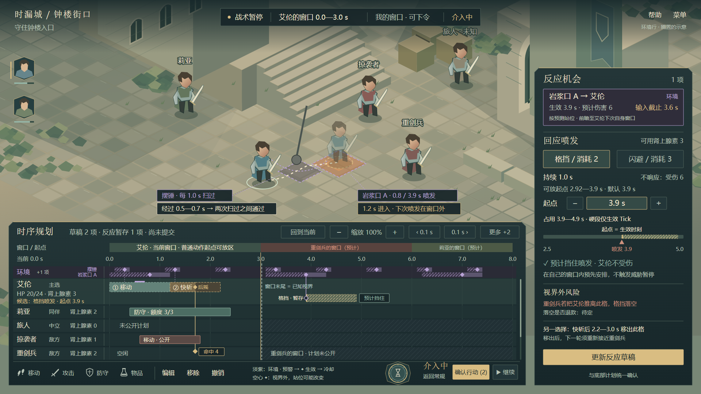

# 环境行示意（搁置）

日期：2026-10-26。这是[环境时序危险](../环境时序危险-灵感稿-2026-10-26.md)的配图。用户把环境时序危险定为搁置的正式内容，近期不加入，所以本图放在灵感目录，不放进 `界面/示意图/`，也不属于 HUD 方案的验收范围。

[可编辑 SVG](env-row-intervention.svg) · [1366×768 检查图](env-row-intervention-1366-check.png)

## 画面要点

- **环境单独成行。** 环境行固定在刻度与单位轨道之间，不参与阵营分组，也不占“一主选＋四紧凑”的名额。行内分两条子行：摆锤、岩浆口 A。另一个与当前选择无关的危险折叠为“+1 项”。
- **每次生效** 画成“预警（斜纹）→ ◆ 生效 → 冷却”。环境用淡紫色，与敌方的红色区分，因为它对所有阵营生效。
- **视界之后照常绘制。** 下一个窗口属于重剑兵，所以窗口末尾与已知视界都在 3.0 s。3.0 s 之后，他方轨道用暗斜纹标为未知，环境行仍然完整画出，因为时刻表是确定的。
- **时机穿行。** 艾伦的移动经过摆锤格的时间是 0.5—0.7 s，正好在 0.3 s 与 1.3 s 两次扫过之间。移动块上方的淡紫短条标出经过时段，虚线标出两次扫过。
- **选项 (b)。** 岩浆口 A 在 0.8 s 喷发后，艾伦 1.2 s 进入该格，快斩重剑兵。下一次喷发是 3.9 s，已在自己的窗口之外，但已进入前瞻范围，所以反应机会已经出现。玩家在自己的窗口内就排好了格挡，起点默认等于生效时刻，不会触发威胁暂停。
- **视界外的接触点画成空心 ◆。** 重剑兵在自己的窗口里可能把艾伦推离此格，届时格挡落空。右侧同时列出另一种选择：快斩之后、窗口结束前移出此格。

## 样例数值

- 窗口为默认 3.0 s。快斩（伤害 4、前摇 0.5 s + 后摇 0.5 s）与生命 24 取自 v0.5 候选基准。
- 摆锤每 1.0 s 扫过一次，预警 0.2 s。岩浆口 A 的周期为 3.1 s，预警 0.8 s、冷却 0.4 s，喷发伤害 6。这些都是构图样例。
- 格挡持续 1.0 s，必须覆盖生效 Tick，所以可放起点为 2.92—3.9 s。输入截止按 0.3 s 提前量画为 3.6 s。

## 未覆盖

- 常规层的位置条与“空闲到下一个自身窗口”一段，本次没有画。
- 落空的格挡是否退款，见灵感稿 §6。

## 生成与检查

- [生成脚本](build_env_row.py) 导入 [HUD v4 的绘图脚本](../../界面/示意图/2026-10-26/build_hud_v4.py)，复用其绘图函数。渲染使用 v4 的 [render_hud_v4.cjs](../../界面/示意图/2026-10-26/render_hud_v4.cjs)，执行时传入本目录与文件名。
- 检查结果见 [svg-layout-check.json](svg-layout-check.json)：无解析错误，无文字越界或重叠。1366×768 下，环境子行的名字约 9 px，正式实现时需要加大。
