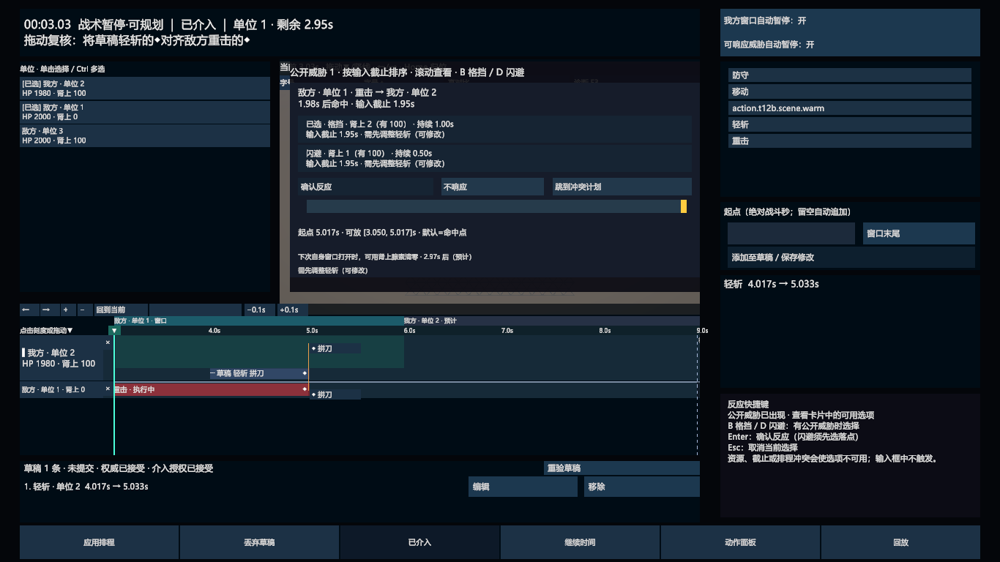

# 介入界面：既有能力与 v2 示意图的差距

日期：2026-10-20。用户指出 v2 信息不全，且常规布局未为介入展开提供足够容量。本次核对既有设计、源码和验收截图，修正后续设计依据；没有修改 Unity 实现，也没有把新示意图视为已验收方案。

## 结论

v2 将介入画成“普通行动区上方加一条个人动作条”，无法承载项目已经实现的多单位时空判断。缺失的内容直接影响拼刀、格挡、闪避和反击决策，不能仅作为后续美术细节补齐。

常规和介入需要作为同一套可重排布局设计。底部介入入口保持核心地位；进入介入时，头像、动作组、短队列和候选结果区须共同让出多轨道与反应详情所需空间。已有信息能力保留，具体皮肤和布局比例重新设计。

用户已确认的新显隐边界继续有效：完整时间轴及精确工具只在主动介入后启用。旧 v0.3 的“暂停即展开”不恢复。旧版已存在的授权/提交状态也不能被新图中的“介入中”几个字替代。

## 这次实际查阅的依据

- [HUD 框架 v0.3](战斗UI-HUD框架-v0.3.md)：§3 多单位轨道、§4 动作与接触点、§5 反应卡、§6 空间联动、§7 完整屏幕。
- [M2 实施](../../优化任务/执行记录/M2-多单位轨道与吸附线-2026-10-15.md)、[M3 实施](../../优化任务/执行记录/M3-防御与反应-2026-10-15.md)、[M4 实施](../../优化任务/执行记录/M4-空间联动-2026-10-16.md)与 [2026-10-17 补验完成记录](../../优化任务/执行记录/M2-M4-补验完成-2026-10-17.md)。实施记录中的历史待验事项按补验记录理解。
- 场景 `CombatSampleScene.unity` 的 NewBattleCanvas 与 BattlePresentationView 绑定；CanvasScaler 参考尺寸为 1980×1080，宽高匹配 0.5。
- [M1HudView](../../Assets/Scripts/UnityView/M1HudView.cs)、[M2TimelineView](../../Assets/Scripts/UnityView/M2TimelineView.cs)、[TimelinePlanView](../../Assets/Scripts/UnityView/TimelinePlanView.cs)、[M3ReactionView](../../Assets/Scripts/UnityView/M3ReactionView.cs)、[M4SpatialView](../../Assets/Scripts/UnityView/M4SpatialView.cs)与 [BattlePresentationView](../../Assets/Scripts/UnityView/BattlePresentationView.cs)。

实际查看的图片包括下列拼刀图，以及 [M3 反应图](../../优化任务/执行记录/M2-M4-输入补验修正-2026-10-16/M3-reaction-native-1366x768.png)、[M4 公开范围图](../../优化任务/执行记录/M2-M4-输入补验修正-2026-10-16/M4-public-range-native-1366x768.png)。这是已保存的验收画面，本轮没有新开 Unity 做运行验收。

## 信息逐项对比

| 既有能力与依据 | v2 示意图的缺口 | 对设计的要求 |
|---|---|---|
| 时钟、窗口归属/剩余时间、提交权限；M1 | 只有“常规规划/介入中”，无法判断谁的窗口、能否下令及授权状态 | 常规与介入都有紧凑状态区；工具显隐不替代权限反馈 |
| 当前与预计窗口序列、普通动作起点可放区；v0.3 §3.1、M2 | 只有一根 6.0 秒末尾线，没有窗口归属/后续窗口/允许起点范围 | 窗口条与动作轨道共用刻度，合法起点区和越界尾段分别表达 |
| 已知视界线、公开他方计划、视界外未知；v0.3 §3.1、M4 | 把窗口末尾当成唯一边界，并只画主角未来 | 窗口边界与已知视界必须分开；显示公开计划和范围，视界外标未知 |
| 多单位同轴轨道，固定阵营/槽位顺序，主选与临时攻击者，滚动和溢出入口；v0.3 §3、M2 | 单角色单行，没有对照对象、主选切换或多选容量 | 主选、受威胁者和相关攻击者能够同时比较；不能改成逐人切页查看 |
| 轨道标题中的 HP、公开肾上腺素，以及对方能否反应；v0.3 §1/§3、M2 | 仅主角 HP；看不到双方反应资源 | 主选与相关对象显示资源；“可被格挡/闪避”有明确原因和资源依据 |
| 前摇—命中—后摇；Guard 额度/耗尽；Block/Dodge 硬软占用、生效和让出点；v0.3 §4、TimelinePlanView | 只有“攻击”长块和一个命中点 | 动作块需要表达阶段和占用性质，足够判断后摇反击、反应接续和提前消耗 |
| 接触点＝何时、何地、谁打谁、预计结果；跨轨道与战场联动；v0.3 §4、M2/M4 | 一个孤立“命中 5.4”不能解释双方交互 | 源/目标、拼刀/格挡/闪避/拦截等结果与接触连线可读；吸附时上下对齐 |
| 反应机会按截止排序；格挡/闪避费用、持续时间、输入截止、可行性、起点范围、抢先消耗、闪避后影响；v0.3 §5、M3 | 完全缺失反应详情；普通“防守”按钮不能替代 | 设计反应列表与当前机会详情；多威胁、禁用原因和冲突跳转有明确位置 |
| 草稿编辑/移除/重验、Editable/锁定/执行状态、待恢复提交/待采纳/拒绝原因；M1～M3 | 一个计数和确认按钮，主要区分候选与已排 | 重要状态和修改入口不能丢失；同一计划的列表与轨道可整合显示，避免重复占位 |
| 缩放、平移、回到当前、游标微调；M2/M4 | 固定 0—7 秒轴，游标只有展示 | 长动作、多窗口和精确对齐需要可读且可操作的时间导航 |
| 角色计划位置/朝向/占位、公开攻击范围、接触点、伤害和击退停止原因；M4 | 一个主角残影与伤害卡 | 战场和结果详情各司其职；已公开的对方空间信息不能被一并排除 |

不是要求这些详情在任何时候全部展开。跨单位时序、相关接触与当前反应是同一次决策所需信息，必须能同时读取；无关详情可以按选择收起。

### 需要纠正的预测边界

此前生图提示词限制“只显示主角预测位置，不显示敌方预测”，遗漏了现有公开信息能力。正确边界是：使用经过控制者过滤的公开计划，在已知视界内投影他方计划位置和公开范围；视界外标未知，不读取隐藏 Editable 计划、不推测未公开反应。v2 的提示词与图保留为历史记录，不继续作为这项能力的约束。

## 空间为什么不够

v2 SVG 为 1600×900。介入编辑面板从 y=574 到 y=683，总高 **109 px**，其中动作行只有 **27 px**；右下结果卡仍占 y=589～874，大头像与底部动作组也保持原尺寸。

M2 源码使用 **62 个 Canvas 单位的固定表头**、**88 的主选轨道（64 正式轨道＋24 草稿行）**、**32 的紧凑轨道**，轨道间距 2。按“一主选＋四紧凑”计算，单是表头和轨道就需要 `62 + 88 + 4×32 + 4×2 = 286` 个 Canvas 单位，尚未包含底部提交/编辑控制与反应详情。Canvas 会缩放，这不是把 286 当作所有分辨率的实测屏幕像素；它说明现有层级的完整容量远超一条 27 px 动作行。另有 380 Canvas 单位高的现有反应卡，其内容无法塞进小型伤害预览。

若在 v2 中保持所有常规控件原尺寸、原位置，只把轨道继续向上加高，就会直接覆盖图中的当前角色、目标与路径。右下结果卡又阻断时间轴横向展开。这正是常规态没有设计好展开空间的问题。

旧实现也有需要改善的地方：`BattlePresentationView.SetHudBattleViewport` 的规划相机矩形为 `(0.28, 0.44, 0.42, 0.45)`，几何面积仅约 **18.9%** 屏幕，反应卡还可能覆盖这一带。这个数值只表示相机矩形，并非实测有效可玩面积。保留旧能力不意味着复制旧屏幕比例。

## 下一版布局必须一起确定的内容

| 区域 | 常规状态 | 进入介入后的重排方向（提案） |
|---|---|---|
| 战场与镜头 | 主体画面，紧凑边缘 HUD | 根据底部展开区和详情区重算安全范围，重新构图，保持主选、目标和路径可见 |
| 介入入口与主控制 | 底部核心入口、普通动作、统一确认 | 保留底部入口锚点和识别；普通动作组紧凑排列，避免复制第二套动作栏 |
| 头像/单位状态 | 当前角色肖像与必要状态 | 肖像装饰收缩，状态并入主选轨道标题；相关单位资源在各自标题可读 |
| 短队列 | 自动衔接的紧凑列表 | 转为同一计划的多轨道表示，保留紧凑提交状态与编辑操作，不叠加完整重复队列 |
| 时间编辑 | 隐藏完整工具，加入前保留小型时间条 | 底部统一工作区承担窗口条、固定刻度、至少一主选＋四紧凑的容量校验、接触连线和提交控制 |
| 动作结果/反应详情 | 候选动作结果与基础威胁 | 使用事先确定的详情区域；反应时显示机会列表和当前卡片，关键截止/可行性不被其他抽屉覆盖 |

展开区域在常规状态可由战场使用，但布局从一开始就要明确哪些控件收缩、哪些迁移、镜头如何让位。下一版不再把“所有常规面板位置和大小不变”作为生图约束。

以上是结构修正方向，具体尺寸尚未通过原型验证。不要再先画一个空场景加单条时间轴，再声称能扩展为完整介入界面。

## 下一轮对照场景

1. 主角与敌方命中对齐的拼刀：同轴双轨、双方资源、连线、结果和战场接触点。
2. 两个攻击者先后命中：格挡被更早攻击消耗，来源攻击未被挡住；反应卡和三条相关轨道同时可读。
3. 闪避选落点：费用/截止、落点覆盖、未来移动失效和战场选点；详情按操作让位。
4. 一主选＋四紧凑轨道以及更多单位溢出：固定表头、主选定位、滚动、未知区与窗口条保持清楚。
5. 草稿过期/拒绝/待采纳、普通模式与介入往返：状态和计划保留，不把切换界面当成提交成功。

上述场景在 1366×768、1920×1080 及放大字号下检查，再进入新一轮视觉定稿。旧 v2 的材质和神器入口只能作为局部视觉参考。
