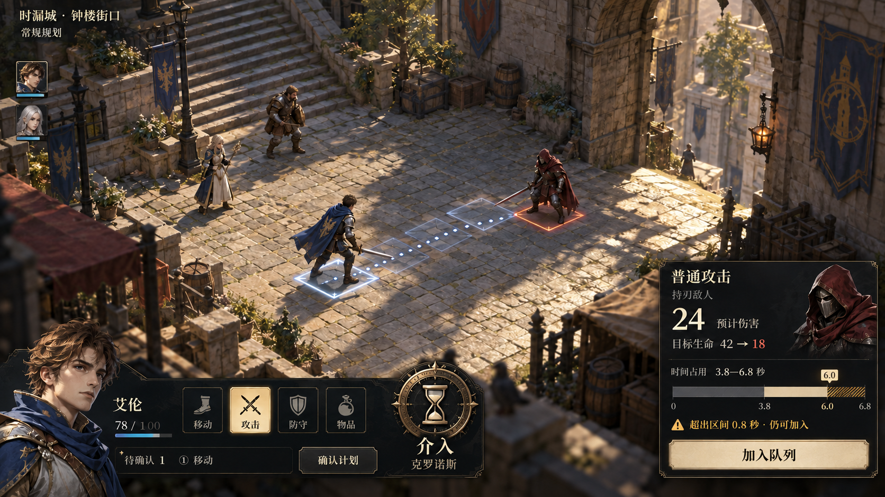
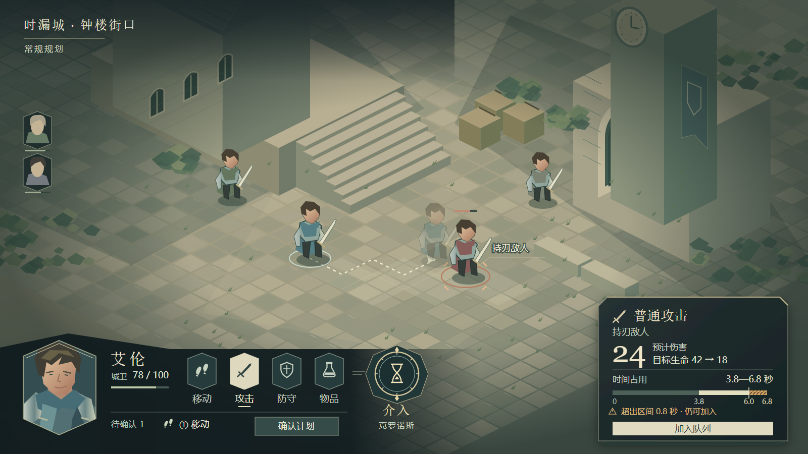
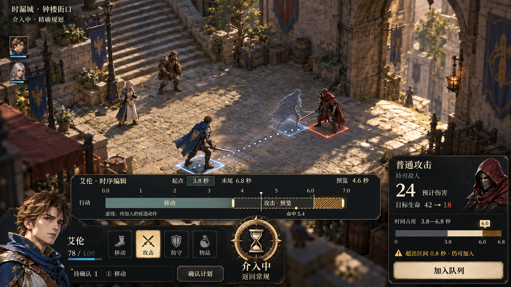
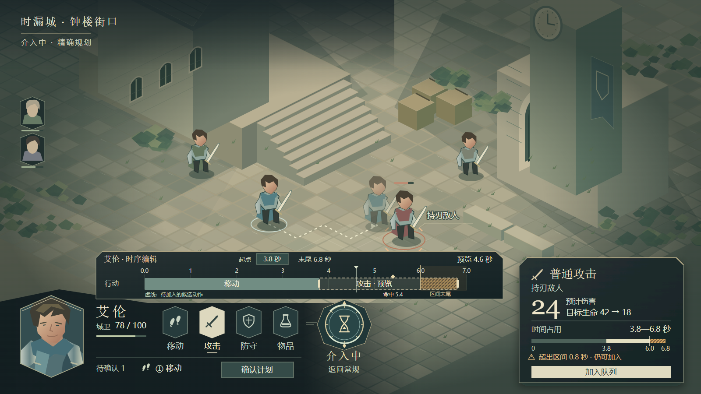

# HUD 视觉示意：常规与介入

新版：[2026-10-20 / v3 四张示意图](../2026-10-20/README.md)。本目录保留历史版本。

**2026-10-20 复核：下列 v2 只保留为局部视觉研究，不能作为完整介入布局。** 多单位同轴、公开敌方计划、视界、反应详情和计划状态缺失，且常规面板未提供足够的重排空间。后续以[介入界面信息与空间复核](../../介入界面信息与空间复核-2026-10-20.md)为修正依据。以下文字说明历史图中画了什么，不表示功能范围已获确认。

日期：2026-10-19。当前版本为 v2：介入是叙事和玩法的核心功能，入口固定在底部主操作区，靠近角色与普通动作。开启后在原位置显示“介入中/返回常规”，精确时间编辑区在上方展开。

以下四张为视觉讨论稿，不代表已实现的 Unity 界面，也不锁定项目最终场景、人物或神器外形。首轮将介入放在右上角的图已废弃为设计依据，文件保留用于版本比较。

## 常规规划

[可编辑 SVG](hero-hud-normal-vector-v2.svg)。同一动作组旁的神器徽记承载“介入”，完整时间编辑尚未展开。普通攻击为加入前候选，左下只有一项待确认移动，右下同时显示结果和只读时间占用。

## 开启介入后

[可编辑 SVG](hero-hud-intervention-vector-v2.svg)。使用同一战场、角色和计划，只展开当前角色的精确编辑视图：时间刻度、动作块、候选动作拖动手柄、起点字段、命中标记、游标和区间末尾。单角色轨道用于本次示意，不代表最终取消多单位轨道功能。

候选攻击以虚线描边，仍未入队；开启介入不会自动提交或清空计划。右下继续显示同一候选结果和越界提示。底部神器入口保持位置，切为“介入中/返回常规”。本图仅表现已进入介入的视觉状态，不确定授权、费用或退出结算规则。

## 时间与数值

- 当前区间：0—6.0 秒；已排移动：0—3.8 秒；候选攻击：3.8—6.8 秒，含恢复段。起点合法，末尾越界 0.8 秒，仍可加入；队列数保持 1。
- 小型时间条：45 px/s，已排段 171 px，本次区间内段 99 px，越界段 36 px，总长 306 px。
- 介入时间轴：105 px/s，显示 0—7 秒；窗口末尾位于 6.0 秒，候选动作延伸到 6.8 秒，不能裁掉越界尾段。
- 命中标记 5.4 秒与游标 4.6 秒为本次演示数值；未来位置预览仅展示当前选中角色，不增加敌方全知预测。
- 艾伦 HP 78/100；目标 HP 42，预计伤害 24，结果为 18。

上述内容均为示例，不是已确认的玩法参数。常规 SVG 的淡色人形表示已排移动落点；介入图则强调当前预览时刻的角色状态。

## 生成方式与文件

生图版通过内置 image_gen 编辑生成，保留上一稿战场。完整提示词：[常规入口修订](imagegen-normal-v2-prompt.txt)、[开启介入](imagegen-intervention-v2-prompt.txt)。首轮生成提示词保留于 [imagegen-prompt.txt](imagegen-prompt.txt)。生图中的细小文字、尺寸和刻度比例仅供视觉参考，精确比例以 SVG 为准。

SVG 为独立可编辑矢量图，PNG 是浏览器直接渲染的 1600 × 900 预览，未对生成图作合成修改。两种状态均已解析、渲染并检查文字边界；常规图不含精确编辑区，介入图包含编辑区，均不使用警告弹窗。此检查不等同于实际游戏的多分辨率验收。

设计依据：[成熟战术游戏 HUD 调研与设计修正](../../成熟战术游戏HUD调研与设计修正-2026-10-19.md)。
