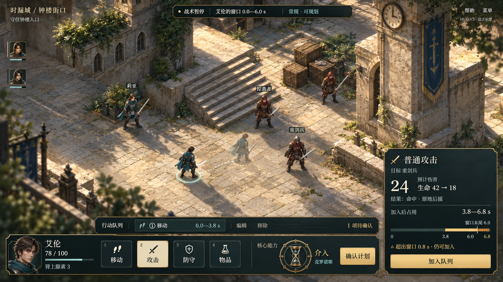
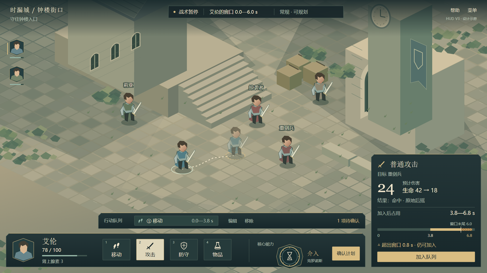
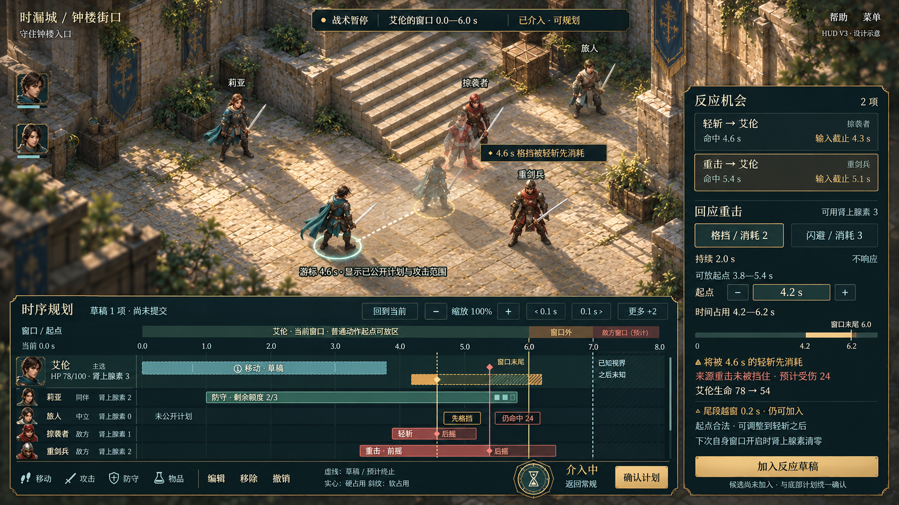
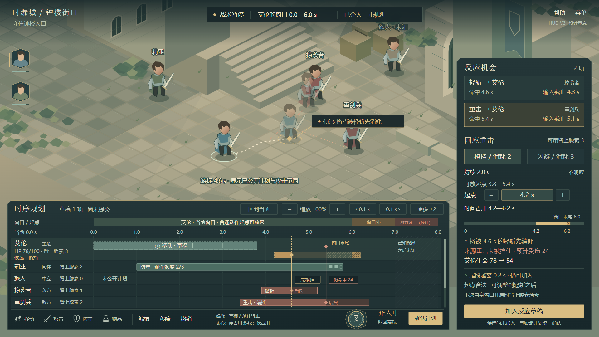

# HUD v3：介入关闭与开启

日期：2026-10-20。根据[既有信息与空间复核](../../介入界面信息与空间复核-2026-10-20.md)重做的四张示意图，供讨论布局与视觉方向。没有修改 Unity 实现，不代表运行截图或已确认的最终方案。

## 介入关闭

[可编辑 SVG](hero-hud-normal-vector-v3.svg)。保留底部主功能组中的介入入口；只有短队列，没有完整时间轴。候选攻击在加入前显示伤害、结果与小型时间位置条。末尾越窗以文字和尾段斜纹表达，加入按钮仍可用。

## 介入开启

[可编辑 SVG](hero-hud-intervention-vector-v3.svg)。短队列转为同一计划的多单位轨道；大头像收缩，主选状态并入轨道标题；底部介入入口保留，装饰尺寸收缩，避免盖住轨道。右侧预览区域向上展开，承接反应机会与当前详情。战场重新构图，把主选、目标与路径保留在上方。

图中可同时查看一条主选轨道、四条紧凑轨道、更多单位入口与滚动条；共用窗口条和刻度；己方与已公开他方动作、前摇/接触/后摇、格挡硬软占用、提前生效后的预计终止段，以及独立的窗口末尾和已知视界。右侧两条反应机会分别保留命中时刻和输入截止，当前反应展示费用、资源、放置起点、时间占用、预期伤害与风险。

这是一张“选中格挡候选”的状态图。闪避落点配置、过期/拒绝/锁定等其他状态仍需后续原型覆盖，不因本图未展开而从功能范围删除。

## 样例情境与边界

两种状态共享同一份 **0.0—3.8 s 移动草稿**，均为一项未提交计划。为了检验不同预览的容量，所选候选动作不同：

- 常规图选择普通攻击：3.8—6.8 s，预计伤害 24，目标生命 42→18。动作末尾超过窗口 0.8 s，仍可加入。
- 介入图选择针对重击的格挡：起点 4.2 s，名义持续到 6.2 s，消耗肾上腺素 2，可用 3。4.6 s 的轻斩先消耗格挡，5.4 s 的来源重击仍造成 24 伤害。名义占用的硬段与软段继续以虚线/斜纹显示，用于解释预计终止后的差异。
- 两个反应机会的输入截止分别为 4.3 s 和 5.1 s，独立于 4.6 s 与 5.4 s 的命中时刻。示例可放起点 3.8—5.4 s 表达当前已有移动后的可用范围，不把输入截止误当作反应起点上限。
- 当前窗口末尾 6.0 s；已知视界 7.0 s；显示范围 0—8 s。视界之后标未知。已公开的敌方计划和范围可以展示，未公开计划不推测。
- 切换界面本身不会把攻击自动替换为格挡，也不会加入、清空或提交计划；两张图展示玩家选择不同候选后的状态。

时间、资源与伤害均为构图样例，不是新规则或本轮仿真的输出。尾段越窗与“下一个动作起点已在窗口外”仍是不同情形；本组图只展示前者。正式运行时由既有逻辑层提供合法性与预测结果。

## 已知偏差（2026-10-26 评审）

对照游戏设计文档与[分层方案 2026-10-26 修订](../../HUD常规界面与介入界面分层方案-讨论稿-2026-10-17.md)发现以下问题。v3 文件保留原样，不作为规则或布局依据；修正后的图见 [HUD v4](../2026-10-26/README.md)。

1. **格挡时长与起点不合法。** 图中格挡持续 2.0 s，默认值是 1.0 s（60 Tick）。持续区间为半开区间，必须覆盖 5.4 s 的命中 Tick，所以起点要晚于 4.4 s。图中的 4.2 s 起点和“可放起点 3.8—5.4 s”都不成立。若要保留“轻斩先消耗格挡”的情境，起点应取约 4.42—4.6 s。
2. **反应不该有越窗提示。** 格挡详情中的“尾段越窗 0.2 s · 仍可加入”套用了普通动作的越窗语义。反应不受窗口限制，这一行应删除。
3. **结果标签画错了轨道。** 介入图中“先格挡”“仍命中 24”两个标签画在旅人（中立）的轨道上，应放在艾伦的轨道或相应的接触连线上。
4. **顶栏用词与新语义冲突。** 介入图顶栏写的是“艾伦的窗口 · 已介入 · 可规划”。按两层语义，自身窗口应写“我的窗口 · 介入中”；“已授权”只用于在他方窗口取得并发授权。
5. **常规图缺少两项信息。**
   - 公开受击标记：同一局面下，重剑兵 5.4 s 的重击会命中艾伦，而普通攻击（3.8—6.8 s）届时仍占着轨道，使格挡无法放置。这应在位置条和提示槽中表达。
   - 暂停中的“继续”入口，或者合并后的“确认并继续”。
6. **窗口长度不是默认值。** 图中窗口为 0.0—6.0 s，默认窗口是 3.0 s（180 Tick）。可以保留作构图样例，但默认值下越界更常见、队列更短，下一轮至少有一张图使用默认值。

## 尺寸与检查

SVG 原稿为 **1920×1080**；PNG 是浏览器直接渲染结果。常规主操作区 y=923—1056，短队列 y=842—904；介入工作区展开到 y=642—1056。右侧详情区固定 x=1464—1896，从常规 y=610 向介入 y=186 展开。展开空间在常规状态用于战场，并非空白占位。

已检查两份 SVG 的 XML 解析、画布文字边界、文字相交，并人工查看 1920×1080 和等比缩放的 1366×768 PNG；最终检查均无文字越界或相交。另检查底部介入徽记不覆盖最后一条轨道。机器检查记录：[svg-layout-check.json](svg-layout-check.json)。

缩小预览仅验证这两张静态稿；不等同于 Unity 自适应布局、放大字号、交互命中或所有反应状态的验收。生图版可能调整局部刻度和文字位置，精确坐标及可编辑内容以 SVG 为准。

## 生成与复用

- 生图使用内置 `image_gen`，没有使用 CLI/API 回退。常规图以常规 SVG 渲染为布局参考；介入图以介入 SVG 渲染为布局参考、常规生图为材质和角色风格参考。介入首次请求网络失败，重试成功。
- 完整提示词：[常规](imagegen-normal-v3-prompt.txt)、[介入](imagegen-intervention-v3-prompt.txt)。
- [SVG 生成脚本](build_hud_v3.py)：沿用 v2 手绘矢量环境与图标，重建两种状态的 HUD；不包含生成图合成或修图步骤。
- [渲染与文字检查脚本](render_hud_v3.cjs)：使用本地 Playwright/Edge，输出 PNG 与检查 JSON。当前脚本依赖本机运行时路径。
- [常规小尺寸检查](hero-hud-normal-vector-v3-1366-check.png)、[介入小尺寸检查](hero-hud-intervention-vector-v3-1366-check.png)。这两张是同一 SVG 的检查预览，不是额外设计版本。

本轮只交付四份设计作品（两份生图、两份 SVG，附 SVG 的 PNG 预览），保留 v1/v2 历史文件。
