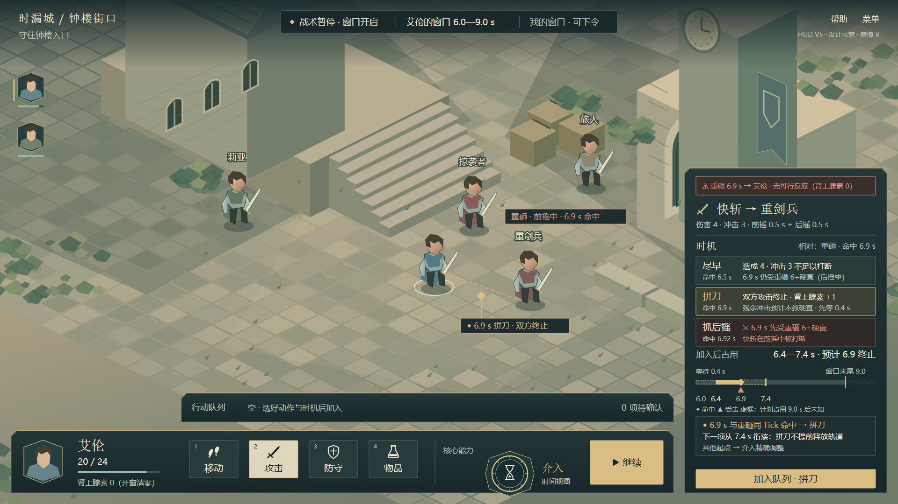
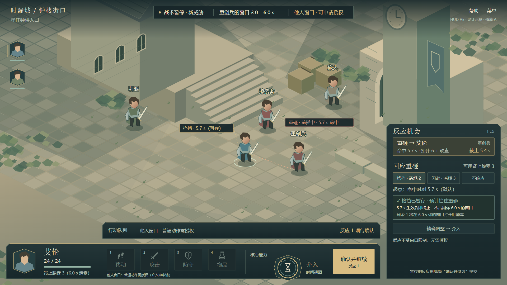
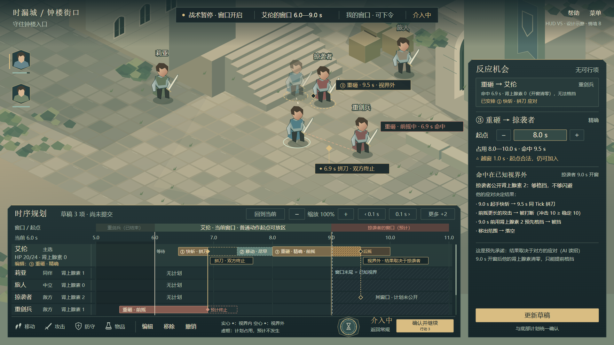
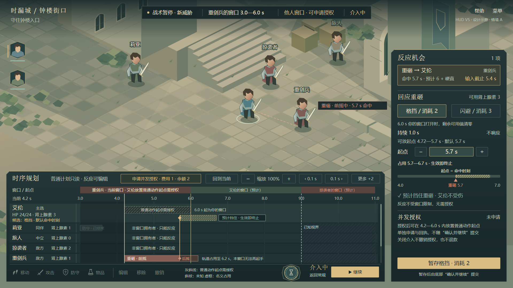

# HUD v5：两个可达快照 × 两层（四张图）

日期：2026-10-26。2026-10-26 评审指出，v4 的情境在现行规则下不可达，敌方攻击在艾伦自己的窗口里起手。本组按[提交、时机与切换状态表](../../常规队列提交时机与切换状态表-2026-10-26.md) §5 的合法快照约束重画，并采用 §2 的主操作提案（D1，待确认）。没有修改 Unity；这些图不是运行截图，数值是 v0.5 候选或构图样例。

## 两个快照

窗口顺序：莉亚 0.0—3.0 → 重剑兵 3.0—6.0 → 艾伦 6.0—9.0 → 掠袭者 9.0—12.0（每个 3.0 s，即默认 180 Tick）。两个快照相互独立，不是同一场战斗的前后两刻。

| | 情境 A（图 2、图 4） | 情境 B（图 1、图 3） |
|---|---|---|
| 当前时刻 | 4.2 s，重剑兵的窗口 | 6.0 s，艾伦的窗口刚打开 |
| 公开威胁 | 重剑兵刚起手的重砸：4.2 起手，5.7 命中，6.2 结束 | 重剑兵在上一窗口起手的重砸：5.4 起手，6.9 命中，7.4 结束 |
| 艾伦肾上腺素 | 3（6.0 s 自身窗口打开时清零） | 0（开窗清零）。威胁在 5.4 s 公开时为 1，不够格挡 |
| 艾伦能做什么 | 格挡、闪避或不响应；普通动作需并发授权 | 普通动作；无法格挡或闪避 |

为什么合法：
- 普通动作只能由窗口拥有者起手，所以在艾伦的窗口里，威胁只能来自开窗前已起手的攻击。
- 情境 A 里，重剑兵的轨道被重砸占到 6.2 s，超过他的窗口末尾 6.0 s，所以本窗口他无法再起手，他的计划已全部可知。
- 非窗口拥有者（莉亚、旅人、掠袭者）在两个快照中都没有可起手的普通动作，所以 v4 里的“未公开计划”一行删去。

## 四张图

### 1. 常规 · 自身窗口 · 相对时机（情境 B）

[SVG](hero-hud-v5-1-normal-own-timing.svg)

- 威胁条写明“无可行反应（肾上腺素 0）”，所以不触发威胁暂停；本次暂停来自窗口开启。
- 三种时机的结果：

  | 时机 | 起点 → 命中 | 预计结果 |
  |---|---|---|
  | 尽早 | 6.0 → 6.5 s | 冲击 3 打断不了重砸；6.9 s 艾伦正在后摇，吃下 6 伤害并硬直 |
  | 拼刀（选中） | 6.4 → 6.9 s | 同 Tick 命中，双方攻击终止，肾上腺素 +1；在这个快照里，这是唯一能化解威胁的进攻选项 |
  | 抓后摇 | 6.42 → 6.92 s | 6.9 s 艾伦还在前摇，先吃重砸 |

- 位置条依评审第 1 条修正：计划占用 6.4—7.4 s（虚框是预计不发生的后摇），◆ 在 6.9 s；提示槽写明“下一项从 7.4 s 衔接：拼刀不提前释放轨道”。
- 队列为空，所以主操作显示“▶ 继续”。

### 2. 常规 · 他人窗口 · 反应卡（情境 A）

[SVG](hero-hud-v5-2-normal-other-reaction.svg)

- 普通动作按钮置灰，注明需授权；队列条写“他人窗口：普通动作需授权”。
- 格挡默认放在命中时刻 5.7 s，已暂存。卡片写明“5.7 s 生效后即终止，不占用你 6.0 s 的窗口”和“剩余 1 将在 6.0 s 开窗时清零”。
- 主操作为“确认并继续 · 反应 1”：只有反应、没有普通动作时也能确认，计数只算反应。

### 3. 介入 · 自身窗口（情境 B）

[SVG](hero-hud-v5-3-intervention-own.svg)

- 艾伦轨道上的三项分别对应状态表 §3.1 的三种来源：
  - ① 快斩 · 拼刀（相对时机，锚点为重砸命中）；
  - ② 移动 · 尽早（自动衔接，从 ① 的计划末尾 7.4 s 起）；
  - ③ 重砸 · 精确（介入中放置，8.0 s 起手，9.5 s 命中，越窗 1.0 s）。
- 窗口末尾与已知视界都在 9.0 s。视界内各轨道完整：莉亚、旅人、掠袭者“无计划”。9.0 s 之后为未知。
- ③ 的命中在视界外，◆ 画成空心。右侧列出掠袭者的四种可能应对：
  - 9.0 s 起手快斩 → 9.5 s 同 Tick 拼刀；
  - 起手前摇更长的攻击 → 被打断；
  - 9.0 s 前用肾上腺素 2 预先格挡 → 被挡（9.0 s 开窗后他的肾上腺素清零）；
  - 移出范围 → 落空。

  这正是“预先承诺”：结果取决于对方 AI 的应对。
- 主操作为“确认并继续 · 行动 3”。

### 4. 介入 · 他人窗口（情境 A）

[SVG](hero-hud-v5-4-intervention-other.svg)

- 艾伦轨道 4.2—6.0 s 标“普通动作起点需授权”，6.0 s 起是他自己的窗口。格挡候选的硬占用只有命中 Tick，软段虚框标“生效即终止”。
- 重剑兵轨道注明“轨道占用至 6.2 s，本窗口无法再起手”。这是从公开信息推出的，不涉及隐藏计划，因此已知视界可以画到 9.0 s。
- 非窗口拥有者三行写“非窗口拥有者 · 只能反应”。
- 格挡尚未暂存，主操作为“▶ 继续”。并发授权单独申请，右侧写明它不随“确认并继续”提交。

## 推演中发现的规则问题（未改规则）

1. **开窗清零让“花不花肾上腺素”在多数情况下不成为取舍。** 情境 A 中，格挡后剩余的 1 会在 6.0 s 清零；即使闪避用掉全部 3，也只是提前花掉本来要清零的余额。只有同一个他人窗口里出现多个威胁、争夺同一笔余额时，费用才构成取舍。
2. **自身窗口内的延续威胁通常无法反应。** 开窗时可用值为 0，所以命中落在你窗口里的威胁，只能在上一个窗口提前格挡（那时余额可能不足），或在自身窗口里用拼刀、防守、移动应对。情境 B 就是这种情况。

这两点会影响 §3.6 反应卡和 §3.7 相对时机在实际战斗中的出现频率，建议与[人物属性与战斗数值 v0.5](../../../战斗测试/人物属性与战斗数值完整方案-v0.5-2026-10-23.md)中的肾上腺素收支一起评估。

## 尺寸与检查

- 生成方式：[build_hud_v5.py](build_hud_v5.py) 导入 [v4 绘图脚本](../2026-10-26/build_hud_v4.py)，复用其绘图函数，只用 Python 标准库。渲染使用 v4 的 [render_hud_v4.cjs](../2026-10-26/render_hud_v4.cjs)，执行时传入本目录与文件名。
- 机器检查见 [svg-layout-check.json](svg-layout-check.json)：四张图均无解析错误，无文字越出画布或重叠，右侧详情区无越界。另已人工查看 1920×1080 和 1366×768 两种尺寸。
- **小屏问题未解决。** 1366×768 检查图仍是等比缩小，介入底栏、图例和时机说明约 9—11 px，只证明“放得进”，不证明“读得舒服”。评审第 5 条要求的重排、轨道滚动和详情展开，需要另做小屏布局，本组没有处理。
