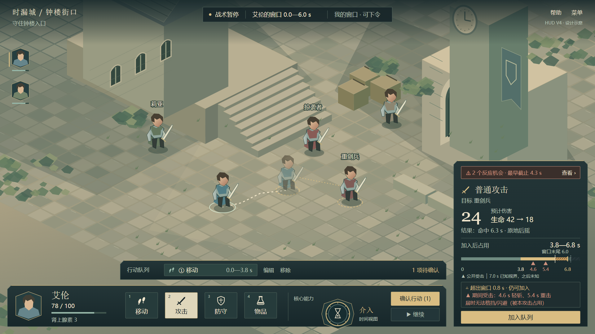
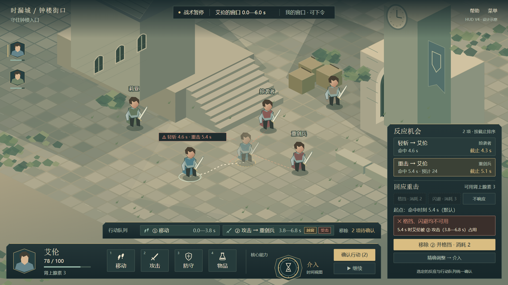
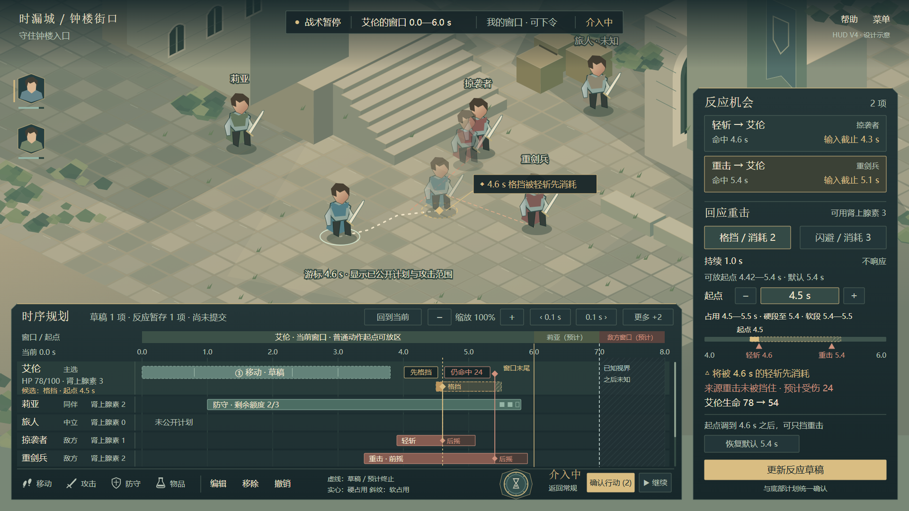
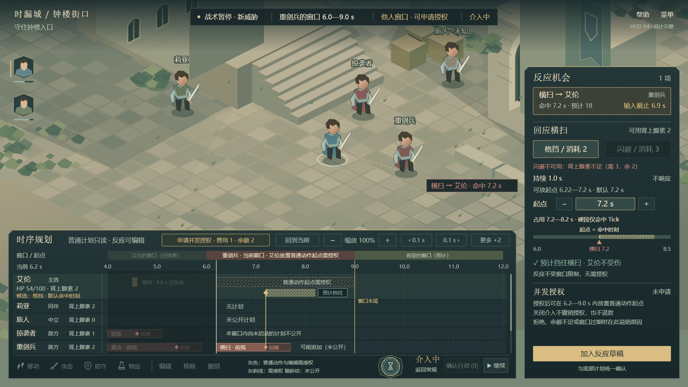
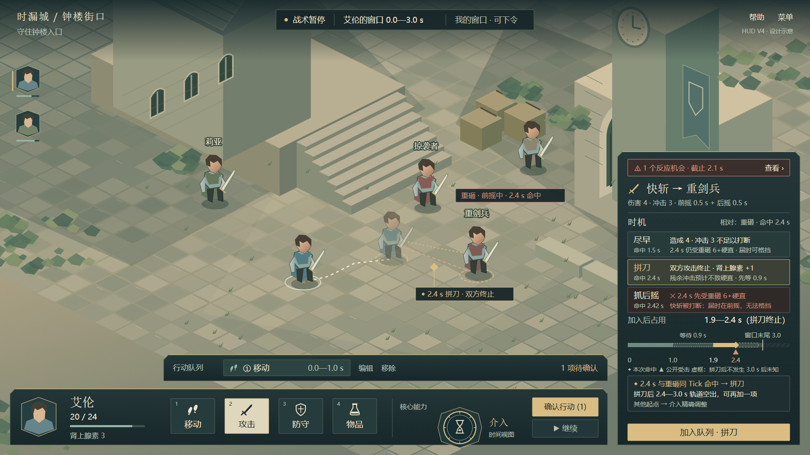

# HUD v4：修订后的常规与介入（五张图）

日期：2026-10-26。依据[分层方案 2026-10-26 修订](../../HUD常规界面与介入界面分层方案-讨论稿-2026-10-17.md)重画，并修正 [v3 的已知偏差](../2026-10-20/README.md#已知偏差2026-10-26-评审)。没有修改 Unity 实现；这些图不是运行截图，也不是已确认的最终方案。

本版只有 SVG 与其 PNG 渲染，没有生图版本。

> **已停用（2026-10-26 二次评审）。** 本组情境在现行规则下不可达，改用 [HUD v5](../2026-10-26-v5/README.md)。主要问题：
>
> - 图 1、2、3、5 中，敌方攻击在艾伦自己的窗口里起手。普通动作只能由窗口拥有者起手，所以这些威胁不会出现。
> - 图 3、4 把旅人（以及图 4 的掠袭者）画成“未公开计划”。非窗口拥有者在视界内没有可起手的普通动作。
> - 图 5 写“拼刀后 2.4—3.0 s 轨道空出”。排程按完整区间占用，下一项只能从计划末尾 2.9 s 开始。
> - 确认按钮的计数口径不一致：图 2 只计队列，图 3 把反应也算进去。
> - 图 2 的“与自身计划冲突”只会出现在他人窗口、并持有并发授权的情况下。
>
> 这些文件保留作追溯，不再作为规则、布局或验收依据。

## 五个状态

图 1～4 是同一场战斗中的一条操作路线：选攻击时看到受击警告 → 仍然加入，反应卡提示冲突 → 移除攻击改为格挡，进入介入微调起点 → 之后在重剑兵的窗口介入，演示申请授权。

### 1. 常规 · 选择动作

[可编辑 SVG](hero-hud-v4-1-normal-plan.svg)

- 顶栏第三格是权限状态（“我的窗口 · 可下令”），不再写“常规 · 可规划”。
- 详情卡顶部常驻“2 个反应机会 · 最早截止 4.3 s”，动作预览不会把威胁盖住。
- 只读位置条：已排部分（灰绿）、候选（金色）、越窗尾段（斜纹）、窗口末尾 6.0 s、已知视界 7.0 s 及之后未知，并用 ▲ 标出 4.6 s、5.4 s 两次指向艾伦的公开命中。
- 固定提示槽有三行：越窗 0.8 s 仍可加入；期间受击；届时无法格挡/闪避（被本攻击占用）。“加入队列”保持可用。
- 底部是“确认行动 (1)”和“▶ 继续”；介入入口位置不变，副标题为“时间视图”。

### 2. 常规 · 反应卡

[可编辑 SVG](hero-hud-v4-2-normal-reaction.svg)

- 玩家仍然加入了攻击；队列项 ② 带“越窗”“受击”两个标记。
- 战场上显示两次公开攻击的范围，以及指向移动后艾伦的标签。
- 反应卡按输入截止排序。格挡默认放在命中时刻（5.4 s）；格挡、闪避都与 ② 冲突，卡内写明原因，并提供“移除 ② 并格挡 · 消耗 2”。
- 需要偏离默认起点时，走“精确调整 → 介入”。卡内没有秒数输入或起点拖动条。

### 3. 介入 · 我的窗口

[可编辑 SVG](hero-hud-v4-3-intervention-own.svg)

- 顶栏把权限（“我的窗口 · 可下令”）和视图状态（“介入中”）分开显示。
- 格挡持续 1.0 s，可放起点 4.42—5.4 s，默认 5.4 s。玩家把起点调到 4.5 s，于是出现“将被 4.6 s 的轻斩先消耗”，并提供“恢复默认 5.4 s”。
- “先格挡”“仍命中 24”两个标签都画在艾伦自己的轨道上。
- 反应详情不再出现“越窗”。小时间条只画格挡的硬/软占用和命中标记，不画窗口边界。
- 窗口条在 6.0—7.0 s 标“莉亚（预计）”，7.0 s 之后标“敌方窗口（预计）”，与已知视界线对应。

### 4. 介入 · 他人窗口

[可编辑 SVG](hero-hud-v4-4-intervention-other.svg)

- 现在是 6.2 s，重剑兵的窗口（6.0—9.0 s），横扫刚刚公开并触发威胁暂停。顶栏为“他人窗口 · 可申请授权 │ 介入中”。
- 打开介入只是看时间轴：艾伦轨道上的普通动作区用灰斜线标“普通动作起点需授权”，底部普通动作和编辑按钮置灰，工作区标题旁有“申请并发授权 · 费用 1 · 余额 2”。
- 反应照常可编辑：格挡默认放在命中时刻 7.2 s，可放起点 6.22—7.2 s；闪避因肾上腺素不足（需 3，余 2）不可用，就地写明原因。
- 敌方在本窗口内尚未启动的计划不公开，以暗斜纹表示；6.2 s 之前的历史压暗显示。
- 右侧说明授权的效果与回执规则：授权后可在 6.2—9.0 s 内放置普通动作起点；关闭介入不撤销授权、不退款。

### 5. 常规 · 相对时机（试行）

[可编辑 SVG](hero-hud-v4-5-normal-timing.svg)

这张图试行[分层方案 §3.7](../../HUD常规界面与介入界面分层方案-讨论稿-2026-10-17.md)：把动作游戏里的时机判断做成常规层的选项，让玩家在“几时出手”上做决定，而不是只看风险提示。它与图 1～4 不属于同一条操作路线，单独使用一组情境：

- **默认窗口 3.0 s**（180 Tick）。下一个窗口属于重剑兵，所以已知视界也在 3.0 s，之后未知。
- **数值改用 v0.5 候选基准**：生命 24、稳定 10；快斩伤害 4、冲击 3、前摇 0.5 s + 后摇 0.5 s；重砸伤害 6、冲击 10、前摇 1.5 s + 后摇 0.5 s。这些仍是待测试的候选值，不是当前运行时数值。
- **局面**：艾伦已排移动 0.0—1.0 s。重剑兵的重砸已启动并公开，0.9 s 起手，2.4 s 命中艾伦，后摇到 2.9 s；冲击 10 达到艾伦的稳定 10，会造成硬直。输入截止按 0.3 s 提前量画为 2.1 s。

详情卡列出三种时机，每种都给出预计结果：

| 时机 | 起点 → 命中 | 预计结果 |
|---|---|---|
| 尽早 | 1.0 → 1.5 s | 造成 4；冲击 3 打断不了重砸；2.4 s 艾伦已空闲，可以格挡 |
| 拼刀（选中） | 1.9 → 2.4 s | 同 Tick 命中，双方攻击终止；残余冲击预计不致硬直；肾上腺素 +1；先等 0.9 s |
| 抓后摇 | 1.92 → 2.42 s | 2.4 s 艾伦正在前摇，先吃重砸并硬直，快斩被打断；届时无法格挡 |

- 位置条显示已排的移动、0.9 s 的等待段、到命中为止的前摇，以及与重砸 ▲ 重合的 ◆。拼刀后不会发生的后摇用虚框表示。
- 提示槽说明拼刀之后 2.4—3.0 s 轨道空出，还能再加一项。其他起点通过介入精确调整。
- 战场上用红色范围和标签标出重砸的前摇，金色 ◆ 标出预计的拼刀接触点。
- “抓后摇”在这个局面里是坏选择，因为艾伦正是重砸的目标。图中保留这一项，是为了表现预览会如实给出坏结果，界面不标推荐。抓后摇真正有用的情形是对方的攻击不指向自己，或者自己赶不及抢先。

## 样例情境与数值

以下数值适用于图 1～4；图 5 的情境见上节。

- 逻辑时间按每秒 60 Tick 换算。窗口画成 6.0 s 是构图样例，默认窗口是 3.0 s。
- 艾伦：移动 0.0—3.8 s；候选普通攻击 3.8—6.8 s，命中 6.3 s，后摇取默认 0.5 s。
- 掠袭者轻斩：前摇 3.9 s 起，命中 4.6 s，后摇至 5.1 s。重剑兵重击：前摇 3.4 s 起，命中 5.4 s，后摇至 5.9 s。输入截止按 0.3 s 提前量画为 4.3 s、5.1 s。
- 格挡持续 1.0 s，持续区间为半开区间且必须覆盖来源命中 Tick，所以可放起点要晚于“命中 − 1.0 s”。图 3 的 4.42 s、图 4 的 6.22 s 都按这一规则取整。
- 生命、伤害、肾上腺素、授权费用和余额都是布局样例，不是规则推算。授权所用资源的名称、费用与余额以后读取配置，图中不写资源名。

## 相对 v3 的修正

| v3 已知偏差 | v4 处理 |
|---|---|
| 格挡画成 2.0 s，起点 4.2 s 不合法 | 改为 1.0 s；起点 4.5 s 位于 4.42—5.4 s 内，并标出默认 5.4 s |
| 格挡详情出现“尾段越窗” | 删除；反应时间条不画窗口边界 |
| 结果标签画在旅人的轨道上 | 改画在艾伦轨道，位于各自接触线左侧 |
| 顶栏“已介入 · 可规划” | 权限与“介入中”分开；他人窗口写“可申请授权” |
| 常规图没有受击标记、没有继续入口 | 位置条加 ▲ 和已知视界；提示槽加受击行；底部加“▶ 继续” |
| 窗口不是默认值 | 保留 6.0 s 便于与 v3 对照，在上文注明默认 3.0 s |

新增内容：常规反应卡（图 2），以及他人窗口的授权状态（图 4）。

## 图中按临时方案画、尚未确定的内容

- **确认与继续**：画成两个独立按钮。也可以合并为“确认并继续”，待 P0 决定。
- **等待/延后**：未画，待 P0 决定是否提供。
- **时间视图的代价**：按“无代价”画，介入入口只标“时间视图”。
- **他人窗口里的已知视界**：图 4 只用“未启动计划不公开”的暗斜纹表达，没有画视界线；画法待按 v0.3 §3.1 复核。
- **常规反应卡**：分层方案 §3.6 中的提案，待原型评审。

## 尺寸与检查

- SVG 原稿为 1920×1080，PNG 由本机 Edge 无头模式直接渲染；`-1366-check.png` 是同一 SVG 等比缩放到 1366×768 的检查图。
- 机器检查结果见 [svg-layout-check.json](svg-layout-check.json)。五张图均无 XML 解析错误，没有文字越出画布，没有文字互相重叠，右侧详情区的文字也没有越过内边距。另已人工查看 1920×1080 与 1366×768 两种尺寸。
- 1366×768 下，最小的图例和禁用按钮文字缩到约 10 px，Unity 实现时需要加大。静态图检查不等于 Unity 自适应布局、130% 字号或交互命中的验收。

## 生成方式

- [SVG 生成脚本](build_hud_v4.py)：只用 Python 标准库，复用 v2 的手绘矢量环境与图标，重建全部 HUD。在本目录运行 `python build_hud_v4.py`。
- [渲染与检查脚本](render_hud_v4.cjs)：使用 Playwright 与 Edge，输出 PNG 和检查 JSON。与 v3 一样依赖本机运行时路径。
